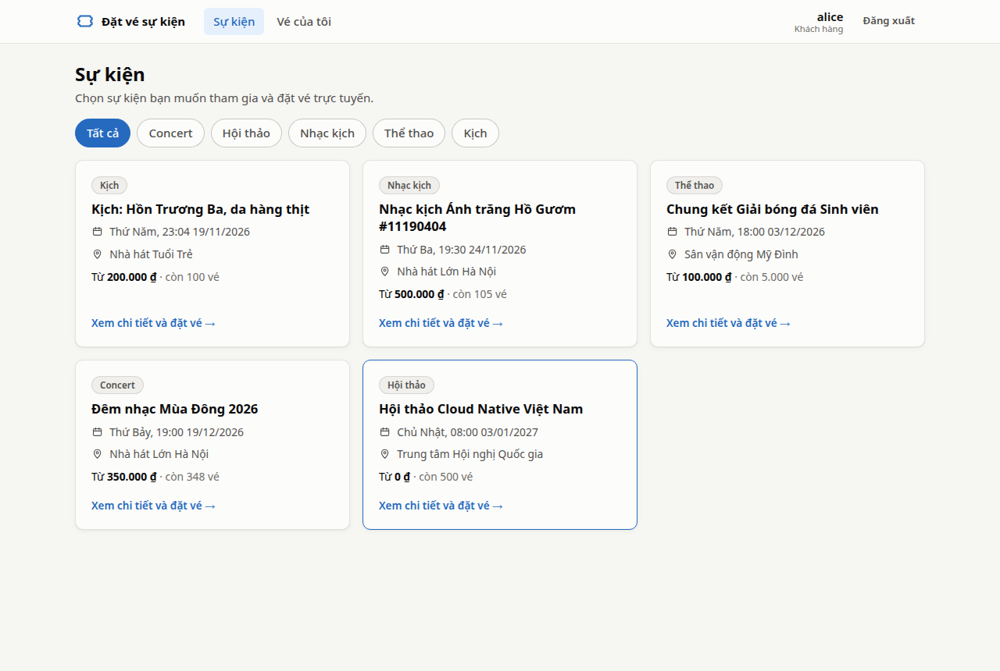
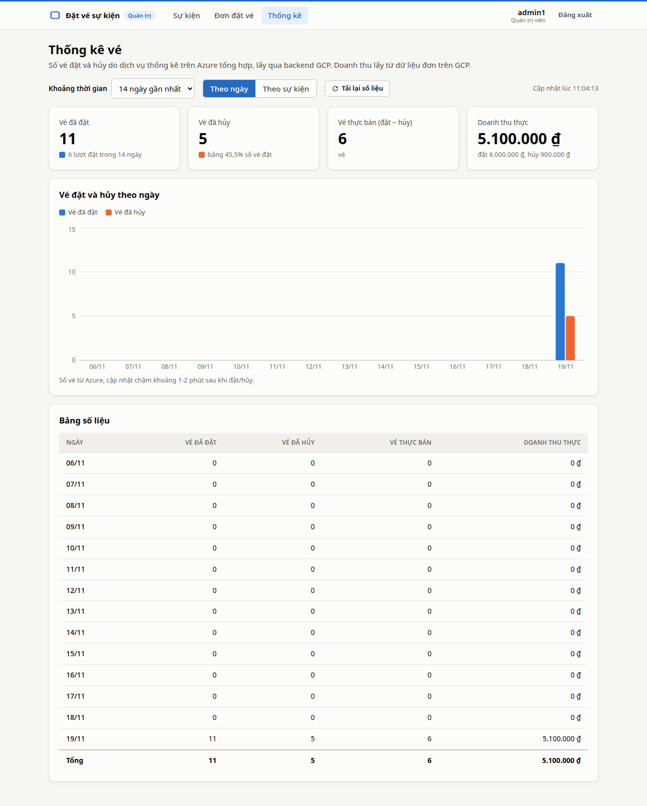

# Hệ thống đặt vé đa sự kiện · Frontend (Nhóm 5)

Giao diện web cho bài tập lớn môn Điện toán đám mây. Khách hàng dùng nó để tìm sự kiện, đặt vé và quản lý vé đã mua. Quản trị viên dùng nó để quản lý sự kiện, hạng vé, đơn hàng và xem thống kê. Hai khu vực nằm chung một ứng dụng và dùng chung màn hình đăng nhập.

Backend nằm ở repo riêng: [DucVu727/cloud-backend](https://github.com/DucVu727/cloud-backend). Hệ thống chạy trên Google Cloud (Cloud Run, Cloud SQL) và Azure (hàng đợi, Functions, API thống kê).

| Khách hàng | Quản trị viên |
|---|---|
|  |  |

## Tính năng

**Khách hàng** (`/events`, `/my-tickets`), phần của Ma Đức Minh:

- Xem sự kiện, lọc theo loại hình và chia trang. Mỗi sự kiện hiện giá thấp nhất và số vé còn lại.
- Đặt vé. Ứng dụng báo lỗi số lượng, hết vé, hay không đủ vé ngay trên form. Nếu mạng rớt lúc đặt và khách bấm lại, hệ thống không tạo đơn trùng (frontend gửi lại cùng `Idempotency-Key`).
- Xem danh sách vé của mình và chi tiết từng đơn. Hủy được đơn kèm lý do nếu còn trước giờ diễn ít nhất 24 giờ. Màn hình hiện rõ hạn hủy của từng đơn.

**Quản trị viên** (`/admin`), phần của Nguyễn Quang Huy:

- Tạo, sửa, hủy sự kiện. Sự kiện có thể để ở trạng thái nháp hoặc mở bán. Khi một sự kiện bị hủy, các đơn còn hiệu lực của nó cũng bị hủy theo.
- Khai báo hạng vé. Ứng dụng không cho giảm số vé xuống thấp hơn số vé khách đã đặt.
- Tra cứu đơn theo sự kiện và trạng thái, kèm tổng số đơn, số vé, số tiền. Quản trị viên hủy được từng đơn.
- Thống kê vé đặt, vé hủy và doanh thu theo ngày hoặc theo sự kiện, có biểu đồ. Backend lấy số liệu này từ API thống kê trên Azure.

Giao diện dùng được trên điện thoại và có chế độ tối. Lỗi từ backend hiện bằng câu tiếng Việt ngay tại chỗ người dùng đang thao tác.

Công nghệ: React 18, TypeScript, Vite, React Router, Recharts. Kiểm thử bằng Vitest, Testing Library và Playwright.

## Chạy thử nhanh (không cần backend)

Cần Node.js 20 trở lên.

```bash
git clone https://github.com/minhmd25/cloud_fe.git
cd cloud_fe
npm install
npm run dev
```

Mở <http://localhost:5173>. Ở chế độ này frontend dùng một backend giả chạy ngay trong trình duyệt (`src/api/mock`). Backend giả có cùng đường dẫn, dữ liệu, mã lỗi và tài khoản mẫu như backend thật. Thanh màu vàng ở chân trang cho phép giả lập mất kết nối và đặt lại dữ liệu mẫu.

| Vai trò | Tài khoản | Mật khẩu |
|---|---|---|
| Khách hàng | `alice` (thêm `bob`, `carol` ở backend giả) | `DemoCustomer2026!` |
| Quản trị viên | `admin1` | `DemoAdmin2026!` |

## Chạy với backend thật trên máy

Cần thêm Docker.

1. Clone [cloud-backend](https://github.com/DucVu727/cloud-backend) và làm theo mục 1 "Khởi chạy nhanh" trong README của repo đó. Giữ nguyên `AUTH_MODE=local`, `PUBLISHER_MODE=mock`, `STATS_MODE=mock` như trong `.env.example` để không gửi dữ liệu thử sang Azure. Khi chạy xong, `curl localhost:3000/health` phải trả về `"auth":"local"`.
2. Chạy frontend:

   ```bash
   npm run dev:api
   ```

3. Mở <http://localhost:5173> và đăng nhập bằng `alice` hoặc `admin1` như bảng trên.

Dev server chuyển tiếp mọi request `/api` sang `http://localhost:3000` (cấu hình trong `.env.api`), nên không phải mở CORS cho localhost.

Nếu máy đã có PostgreSQL khác chiếm cổng 5432, đổi cổng của service `db` trong `docker-compose.yml` của backend và sửa `DATABASE_URL` cho khớp.

## Các lệnh

| Lệnh | Việc làm |
|---|---|
| `npm run dev` | Chạy với backend giả trong trình duyệt |
| `npm run dev:api` | Chạy với backend trên máy (`localhost:3000`) |
| `npm run dev:cloud` | Chạy với backend trên Cloud Run (`ticket-api`) |
| `npm run build` | Kiểm tra kiểu rồi build bản tĩnh vào `dist/` |
| `npm run typecheck` | Kiểm tra kiểu TypeScript |
| `npm test` | 50 test cho lớp gọi API, giao diện khách hàng và giao diện quản trị |
| `npm run e2e` | 5 kịch bản Playwright trên Chrome, dùng backend giả |
| `npm run e2e:api` | Cùng 5 kịch bản, dùng backend thật ở `localhost:3000` |

## Kiểm thử

Kịch bản e2e tự tạo một sự kiện riêng rồi đi hết luồng sau:

1. Quản trị viên tạo sự kiện và hạng vé.
2. Khách lọc sự kiện và đặt vé. Mạng rớt đúng lúc đặt, khách bấm lại, và hệ thống không tạo đơn trùng.
3. Khách hủy đơn. Đơn quá hạn hủy không hủy được. Khách thường không vào được trang quản trị, và khách này không xem được đơn của khách khác.
4. Quản trị viên thấy đơn đúng và thống kê đúng.
5. Giao diện hiển thị đúng trên điện thoại và ở chế độ tối.

Kịch bản chạy trên Google Chrome đã cài sẵn trong máy. Nếu máy chưa có Chrome, chạy `npx playwright install chrome`. Thêm `E2E_SCREENSHOTS=1` trước lệnh để lưu ảnh chụp màn hình vào `docs/screenshots`.

`npm run e2e:api` cần thêm tài khoản khách thứ hai là `bob`, vì backend chỉ tạo sẵn `alice` và `admin1`. Chạy lệnh sau trong thư mục backend:

```bash
npx tsx -e 'const { createPool } = require("./src/db"); const { hashPassword } = require("./src/auth/passwords"); (async () => { const db = createPool(); await db.query(`INSERT INTO accounts (user_id, username, password_hash, role) VALUES ($1, $1, $2, $3) ON CONFLICT (user_id) DO NOTHING`, ["bob", await hashPassword("DemoCustomer2026!"), "customer"]); await db.end(); console.log("Đã có tài khoản bob"); })()'
```

> [!WARNING]
> `npm run e2e:api` ghi dữ liệu thật vào database của backend đang chạy. Đừng chạy nó vào backend trên cloud khi backend đó đã nối với hàng đợi Azure, vì số liệu thống kê dùng để demo sẽ bị lẫn dữ liệu thử.

## Triển khai lên Cloud Run

Image build bằng `Dockerfile`: bước đầu build bản tĩnh, sau đó nginx phục vụ ở cổng `$PORT` (mặc định 8080).

```bash
# Tạo kho image (chỉ làm một lần)
gcloud artifacts repositories create nhom5 --repository-format=docker --location=asia-southeast1

# Build và đẩy image bằng Cloud Build
gcloud builds submit . \
  --tag asia-southeast1-docker.pkg.dev/<PROJECT_ID>/nhom5/frontend:v1

# Triển khai
gcloud run deploy ticket-web \
  --image asia-southeast1-docker.pkg.dev/<PROJECT_ID>/nhom5/frontend:v1 \
  --region asia-southeast1 \
  --allow-unauthenticated \
  --set-env-vars API_BASE_URL=https://ticket-api-5iqotxgmrq-as.a.run.app
```

Container đọc các biến sau lúc khởi động, nên đổi giá trị không cần build lại image:

| Biến | Ý nghĩa |
|---|---|
| `API_BASE_URL` | Địa chỉ backend, không có `/` ở cuối |
| `USE_MOCK` | Đặt `true` để chạy demo bằng backend giả khi backend thật chưa sẵn sàng |

Hai điều phải kiểm tra trước khi triển khai:

- Backend trên cloud phải chạy `AUTH_MODE=local`, nếu không thì frontend không đăng nhập được.
- URL của frontend phải nằm trong `CORS_ORIGIN` của backend. Hiện backend đã cho phép `ticket-web` và `ticket-admin`.

Frontend không chứa mật khẩu database hay khóa Azure. Mọi thông tin bí mật nằm ở backend.

Muốn chạy thử image trên máy:

```bash
docker build -t nhom5-frontend .
docker run -p 8080:8080 -e USE_MOCK=true nhom5-frontend
```

## Cấu trúc thư mục

```text
src/
  api/            gọi API: client.ts (lỗi, token, timeout), index.ts (các hàm API), types.ts
    mock/         backend giả: dữ liệu mẫu (db.ts) và xử lý request (server.ts)
  auth/           phiên đăng nhập, chặn trang khi chưa đăng nhập hoặc không có quyền
  components/     khung trang, thông báo, trạng thái tải/rỗng/lỗi, phân trang
  lib/            định dạng tiền, ngày giờ (giờ Việt Nam), hook tải dữ liệu
  pages/
    LoginPage.tsx   đăng nhập (dùng chung)
    customer/       giao diện khách hàng
    admin/          giao diện quản trị
  test/           test giao diện
e2e/              kịch bản Playwright
docs/             tài liệu kết nối backend, báo cáo, ảnh chụp màn hình
nginx/            cấu hình nginx cho image
Dockerfile        đóng gói để triển khai
```

Mọi lời gọi API nằm trong [`src/api/index.ts`](src/api/index.ts). Nếu backend đổi đường dẫn hay dữ liệu, chỉ cần sửa file này.

## Tài liệu

- [Kết nối frontend với backend](docs/KET-NOI-BACKEND.md): màn hình nào gọi API nào, cách xử lý từng mã lỗi
- [API của backend](https://github.com/DucVu727/cloud-backend/blob/main/docs/API.md)
- [Báo cáo phần giao diện khách hàng](docs/bao-cao-ma-duc-minh.md) (Ma Đức Minh)
- [Báo cáo phần giao diện quản trị](docs/bao-cao-nguyen-quang-huy.md) (Nguyễn Quang Huy)
