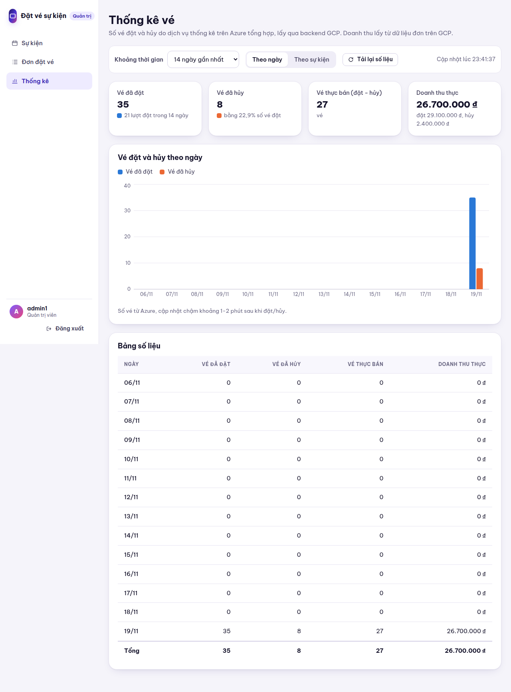

# Hệ thống đặt vé đa sự kiện (Nhóm 5)

Bài tập lớn môn Điện toán đám mây. Khách hàng tìm sự kiện, đặt vé và hủy vé. Quản trị viên quản lý sự kiện, hạng vé, đơn hàng và xem thống kê doanh thu. Hệ thống chạy trên Google Cloud (Cloud Run, Cloud SQL) và Azure (Storage Queue, Functions, API thống kê).

| Khách hàng | Quản trị viên |
|---|---|
|  |  |

## Phân công

| Thành viên | Phần việc | Thư mục |
|---|---|---|
| Ma Đức Minh | Giao diện khách hàng | `frontend/src/pages/customer` |
| Nguyễn Quang Huy | Giao diện quản trị | `frontend/src/pages/admin` |
| Đoàn Việt Đức | API tài khoản và phân quyền | `cloud-backend/src/auth` |
| Vũ Ngọc Đức | API sự kiện, đặt vé, outbox | `cloud-backend/src` |
| Hoàng Quốc Dương | Triển khai trên GCP | mục 7 |
| Trương Gia Sinh | Thống kê trên Azure | [`cloud-backend/docs/azure-message-contract.md`](cloud-backend/docs/azure-message-contract.md) |

## 1. Tổng quan

```text
Trình duyệt
   │
   ▼
frontend (Cloud Run, nginx)            React app: khu khách hàng và khu quản trị
   │  /api/...
   ▼
ticket-api (Cloud Run, Node.js) ─────▶ Cloud SQL PostgreSQL   sự kiện, hạng vé, đơn, tài khoản, outbox
   │                    │
   │ đọc thống kê       │ worker outbox gửi mỗi lần đặt/hủy
   ▼                    ▼
API thống kê ◀──── Azure Functions ◀──── Azure Storage Queue "ticket-events"
```

- Backend giữ **dữ liệu đơn chính thức**. Mỗi lần đặt hoặc hủy đơn, backend ghi kèm một thông điệp vào bảng outbox trong cùng giao dịch. Worker chạy ngầm gửi thông điệp sang Azure và tự gửi lại khi Azure lỗi, nên không mất số liệu.
- Azure tổng hợp số vé đặt và hủy. Trang thống kê của quản trị viên gọi backend, backend đọc API thống kê của Azure rồi ghép thêm doanh thu từ database.
- Frontend chỉ gọi backend. Mật khẩu database, khóa JWT và khóa Azure chỉ nằm ở backend.

| Thư mục | Nội dung | Công nghệ |
|---|---|---|
| [`cloud-backend/`](cloud-backend) | API, worker outbox, migration, seed | Node.js 22, TypeScript, Express 5, PostgreSQL 16, Zod, Vitest + Supertest |
| [`frontend/`](frontend) | Giao diện web cho khách hàng và quản trị viên | React 18, TypeScript, Vite, React Router, Recharts, Vitest, Playwright |

## 2. Tính năng

**Khách hàng** (`/events`, `/my-tickets`):

- Xem sự kiện, lọc theo loại hình, có chia trang. Mỗi sự kiện hiện giá thấp nhất và số vé còn lại.
- Đặt tối đa 10 vé mỗi đơn. Backend chống bán vượt số vé, kể cả khi nhiều người tranh vé cuối cùng lúc.
- Nếu mạng rớt lúc đặt và khách bấm lại, hệ thống không tạo đơn trùng: frontend gửi lại cùng `Idempotency-Key`, backend trả lại đơn cũ.
- Xem vé của mình và chi tiết từng đơn. Hủy được đơn kèm lý do nếu còn ít nhất 24 giờ trước giờ diễn, màn hình hiện rõ hạn hủy. Khách không xem được đơn của người khác.
- Chọn ghế trên sơ đồ với các hạng vé bán theo ghế. Một ghế không bao giờ bị bán cho hai người. Nếu có ghế vừa bị người khác đặt, cả đơn bị từ chối và khách chọn lại. *(Backend đã có, giao diện đang làm.)*
- Sự kiện đông người mua dùng hàng chờ ảo. Người vào trước giờ mở bán được xếp thứ tự ngẫu nhiên lúc mở bán, tới lượt mới được mua trong một khoảng thời gian giới hạn. *(Backend đã có, giao diện đang làm.)*

**Quản trị viên** (`/admin`):

- Tạo, sửa, hủy sự kiện. Sự kiện có trạng thái nháp hoặc mở bán. Hủy sự kiện thì mọi đơn còn hiệu lực bị hủy theo.
- Khai báo hạng vé. Không giảm được số vé xuống dưới số vé khách đã đặt.
- Lưu sơ đồ ghế tự do (tọa độ, góc xoay, khu ghế, tới 5000 ghế), khóa/mở ghế, chép sơ đồ từ sự kiện khác. Cấu hình hàng chờ: giờ mở bán, số người mua cùng lúc, số phút mỗi lượt. *(Backend đã có, giao diện đang làm.)*
- Tra cứu đơn theo sự kiện và trạng thái, kèm tổng số đơn, số vé, số tiền. Hủy được từng đơn.
- Thống kê vé đặt, vé hủy và doanh thu theo ngày hoặc theo sự kiện, có biểu đồ. Khi Azure không phản hồi, trang vẫn hiện số liệu lưu tạm kèm cảnh báo.

Giao diện dùng được trên điện thoại và có chế độ tối.

## 3. Chạy trên máy

Cần Node.js 20 trở lên và Docker.

### 3.1. Chỉ chạy frontend (không cần backend)

```bash
cd frontend
npm install
npm run dev
```

Mở <http://localhost:5173>. Ở chế độ này frontend dùng một backend giả chạy ngay trong trình duyệt (`frontend/src/api/mock`), có cùng đường dẫn, dữ liệu, mã lỗi và tài khoản như backend thật. Thanh màu vàng ở chân trang cho phép giả lập mất kết nối và đặt lại dữ liệu mẫu.

### 3.2. Chạy cả backend và frontend

Terminal thứ nhất, bật backend:

```bash
cd cloud-backend
npm install

# Tạo .env rồi điền AUTH_JWT_SECRET bằng giá trị lệnh thứ hai in ra
cp .env.example .env
node -e "console.log(require('node:crypto').randomBytes(32).toString('hex'))"

# Bật PostgreSQL (tự tạo 2 database: ticketing và ticketing_test)
docker compose up -d db

# Tạo bảng và dữ liệu mẫu
npm run migrate
npm run seed:accounts -- --demo
npm run seed            # hoặc: npm run seed -- --reset  (xóa sạch rồi seed lại)

# Chạy API, tự tải lại khi sửa code
npm run dev             # http://localhost:3000
```

`.env.example` để sẵn `AUTH_MODE=local` (đăng nhập trong backend), `PUBLISHER_MODE=mock` và `STATS_MODE=mock` (không gửi dữ liệu thử sang Azure). Kiểm tra: `curl http://localhost:3000/health` phải có `"auth":"local"`.

Terminal thứ hai, bật frontend:

```bash
cd frontend
npm install
npm run dev:api
```

Mở <http://localhost:5173>. Dev server của Vite chuyển tiếp mọi request `/api` sang `http://localhost:3000` (cấu hình trong `frontend/.env.api`), nên không phải mở CORS cho localhost.

Nếu máy đã có PostgreSQL khác chiếm cổng 5432, đổi cổng của service `db` trong `cloud-backend/docker-compose.yml` và sửa `DATABASE_URL`, `TEST_DATABASE_URL` trong `.env` cho khớp.

Các chế độ chạy frontend:

| Lệnh (trong `frontend/`) | Gọi tới |
|---|---|
| `npm run dev` | Backend giả trong trình duyệt |
| `npm run dev:api` | Backend trên máy, `localhost:3000` |
| `npm run dev:cloud` | Backend trên Cloud Run, `ticket-api` |

### 3.3. Tài khoản và dữ liệu mẫu

| Vai trò | Tài khoản | Mật khẩu thử trên máy |
|---|---|---|
| Khách hàng | `alice` | `DemoCustomer2026!` |
| Quản trị viên | `admin1` | `DemoAdmin2026!` |

`npm run seed:accounts -- --demo` tạo hai tài khoản trên và chạy lại được mà không đổi mật khẩu. Backend giả của frontend có thêm `bob`, `carol` (cùng mật khẩu khách hàng).

Thử đăng nhập bằng API:

```bash
curl -X POST http://localhost:3000/api/auth/login \
  -H 'Content-Type: application/json' \
  -d '{"username":"alice","password":"DemoCustomer2026!"}'
curl http://localhost:3000/api/me -H 'Authorization: Bearer <JWT>'
```

`npm run seed` tạo dữ liệu sau:

| Sự kiện | Loại hình | Ghi chú |
|---|---|---|
| Đêm nhạc Mùa Đông 2026 | concert | 3 hạng vé, trong đó **VVIP chỉ có 1 vé** để thử tranh vé cuối |
| Chung kết Giải bóng đá Sinh viên | sport | 2 hạng vé |
| Hội thảo Cloud Native Việt Nam | conference | có hạng vé giá 0đ |
| Kịch: Hồn Trương Ba, da hàng thịt | theater | diễn sau **12 giờ**, dùng để thử quá hạn hủy |
| Lễ hội Ẩm thực đường phố | festival | **DRAFT**, khách không thấy |
| Nhạc kịch: Những người khốn khổ | theater | **sơ đồ 367 ghế** trên 14 hàng cong, 3 hạng vé theo ghế. **Hàng chờ** mở bán sau 5 phút kể từ lúc seed, 2 người mua cùng lúc |

Kèm 4 đơn mẫu (alice 3 đơn, bob 1 đơn), trong đó 1 đơn đã hủy. Một đơn của alice là 2 ghế A3, A4 ở nhà hát.

### 3.4. Trang test API thủ công: <http://localhost:3000/dev>

Đây là một file HTML duy nhất ([`cloud-backend/dev-console/index.html`](cloud-backend/dev-console/index.html)) để thử API, **không phải frontend thật**. Trang chỉ bật khi `NODE_ENV` khác `production` (ép bật/tắt bằng `DEV_CONSOLE=true/false`), và bản cloud đặt `DEV_CONSOLE=false`. Trang dùng token mock, nên phải đặt `AUTH_MODE=mock` rồi khởi động lại backend.

| Tab | Thử được gì |
|---|---|
| Sự kiện & đặt vé | Lọc theo loại hình, xem hạng vé và số còn lại, đặt vé, giả lập bấm "Đặt" 2 lần (Idempotency-Key), **tranh vé đồng thời** (N khách đặt cùng lúc) |
| Đơn của tôi | Danh sách và hủy đơn (hủy lần 2 nhận 409, quá hạn nhận 422), dán ID đơn của người khác để thử quyền truy cập (404) |
| Quản trị | Tạo và sửa sự kiện, hạng vé (thử giá âm, giảm vé dưới số đang giữ), tra đơn theo sự kiện và trạng thái, hủy đơn |
| Outbox & thống kê | PENDING/SENT/FAILED, chạy worker, gửi lại; xem thống kê |

Đổi người dùng ở góc trên bên phải (alice, bob, carol, admin1). Cột bên phải ghi lại mọi request và response. Để thử Azure lỗi, chạy server với `PUBLISHER_MOCK_FAIL=true`, đặt vài vé, rồi tắt cờ và khởi động lại để thấy worker tự gửi lại.

### 3.5. Tạo token test bằng script

Dùng khi muốn gọi API mà không đăng nhập, ở chế độ `AUTH_MODE=jwt` hoặc `local`. Bản cloud **không nhận** token `mock:`. Script tạo JWT ngắn hạn (HS256, claim `sub` và `role`, kèm `iss`/`aud` của chế độ `local`) bằng cùng secret mà server dùng. Ở chế độ `local`, `--sub` phải là `user_id` có trong bảng `accounts`, và vai trò lấy từ database chứ không lấy từ `--role`.

```powershell
# nạp secret vào biến môi trường của phiên terminal, KHÔNG ghi ra file
$env:AUTH_JWT_SECRET = gcloud secrets versions access 1 --secret=ticket-jwt-secret
$token = npm run --silent token -- --sub admin1 --role admin --ttl 30
curl.exe -H "Authorization: Bearer $token" https://ticket-api-5iqotxgmrq-as.a.run.app/api/me
Remove-Item Env:AUTH_JWT_SECRET
```

Script chỉ in token ra màn hình. Không dán token vào log, tài liệu hay repo. Token hết hạn sau `--ttl` phút (mặc định 60).

## 4. Kiểm thử

| Lệnh | Thư mục | Kiểm tra gì |
|---|---|---|
| `npm test` | `cloud-backend` | 103 test tích hợp chạy trên PostgreSQL thật (cần `docker compose up -d db`) |
| `npm test` | `frontend` | 50 test cho lớp gọi API, giao diện khách hàng và giao diện quản trị |
| `npm run e2e` | `frontend` | 5 kịch bản Playwright trên Chrome, dùng backend giả |
| `npm run e2e:api` | `frontend` | Cùng 5 kịch bản, dùng backend thật ở `localhost:3000` |
| `npm run typecheck` | cả hai | Kiểm tra kiểu TypeScript |

Test backend dùng database `ticketing_test` (đặt bởi `TEST_DATABASE_URL`). Database này **bị xóa dữ liệu** mỗi lần chạy test. Nếu Vitest báo lỗi khởi tạo worker fork trên Windows, chạy `npm test -- --pool=threads`.

Kịch bản e2e tự tạo một sự kiện riêng rồi đi hết luồng:

1. Quản trị viên tạo sự kiện và hạng vé.
2. Khách lọc sự kiện và đặt vé. Mạng rớt đúng lúc đặt, khách bấm lại, hệ thống không tạo đơn trùng.
3. Khách hủy đơn. Đơn quá hạn hủy không hủy được. Khách không vào được trang quản trị và không xem được đơn của khách khác.
4. Quản trị viên thấy đơn và thống kê đúng.
5. Giao diện hiển thị đúng trên điện thoại và ở chế độ tối.

Kịch bản chạy trên Google Chrome cài trong máy. Nếu máy chưa có Chrome, chạy `npx playwright install chrome`. Thêm `E2E_SCREENSHOTS=1` trước lệnh để lưu ảnh chụp vào `frontend/docs/screenshots`.

`npm run e2e:api` cần thêm tài khoản khách thứ hai là `bob`. Chạy lệnh sau trong `cloud-backend/`:

```bash
npx tsx -e 'const { createPool } = require("./src/db"); const { hashPassword } = require("./src/auth/passwords"); (async () => { const db = createPool(); await db.query(`INSERT INTO accounts (user_id, username, password_hash, role) VALUES ($1, $1, $2, $3) ON CONFLICT (user_id) DO NOTHING`, ["bob", await hashPassword("DemoCustomer2026!"), "customer"]); await db.end(); console.log("Đã có tài khoản bob"); })()'
```

> [!WARNING]
> `npm run e2e:api` ghi dữ liệu thật vào database của backend đang chạy. Đừng chạy nó vào backend trên cloud khi backend đó đã nối với queue Azure, vì số liệu thống kê dùng để demo sẽ bị lẫn dữ liệu thử.

## 5. Biến môi trường

### 5.1. Backend

Xem đầy đủ trong [`cloud-backend/.env.example`](cloud-backend/.env.example).

| Biến | Mặc định | Ý nghĩa |
|---|---|---|
| `DATABASE_URL` | postgres://…/ticketing | Chuỗi kết nối Postgres |
| `DB_POOL_MAX` | `5` | Số kết nối tối đa tới Postgres (Cloud SQL `db-f1-micro` dùng chung nên để nhỏ) |
| `CORS_ORIGIN` | `*` | Một origin hoặc danh sách cách nhau bằng dấu phẩy (URL các frontend) |
| `AUTH_MODE` | `local` trong `.env.example`; nếu bỏ trống: `mock` (dev), `local` (`NODE_ENV=production`) | `local` \| `mock` \| `jwt` \| `http` (xem mục 6) |
| `AUTH_JWT_SECRET` | | **Bí mật.** Khóa JWT HS256, cần ít nhất 32 byte trong chế độ `local` |
| `AUTH_TOKEN_TTL_SECONDS` | `3600` | Số giây hiệu lực của token do backend cấp |
| `CANCELLATION_DEADLINE_HOURS` | `24` | Khách chỉ được hủy khi còn ít nhất N giờ trước giờ diễn |
| `MAX_TICKETS_PER_ORDER` | `10` | Số vé tối đa mỗi đơn |
| `PUBLISHER_MODE` | `mock` | `mock` (kiểm tra mẫu thông điệp rồi ghi log) \| `azure-queue` (gửi vào Azure Storage Queue) |
| `AZURE_QUEUE_SAS_URL` | | **Bí mật.** URL queue `ticket-events` kèm SAS (chỉ quyền ghi, hết hạn 15/01/2027) |
| `PUBLISHER_MOCK_FAIL` | `false` | Giả lập Azure lỗi để thử cơ chế gửi lại |
| `OUTBOX_POLL_INTERVAL_MS` | `5000` | Chu kỳ worker quét outbox |
| `OUTBOX_BATCH_SIZE` | `20` | Số thông điệp worker nhận mỗi lượt |
| `OUTBOX_LEASE_MS` | lô × `AZURE_TIMEOUT_MS` + 30s, tối thiểu 60s | Thời gian một lượt worker giữ lô đã nhận. Thường không cần đặt |
| `OUTBOX_MAX_ATTEMPTS` | `10` | Quá số lần thử thì chuyển sang FAILED, chờ admin gửi lại. Mức 10 ≈ 36 phút Azure lỗi liên tục, mức 20 ≈ 3 giờ |
| `QUEUE_TICK_MS` | `2000` | Chu kỳ worker hàng chờ: xếp ngẫu nhiên lúc mở bán, cho người vào, xử lý hết hạn. `0` để tắt worker |
| `QUEUE_STALE_SECONDS` | `120` | Người đang chờ không hỏi lại trạng thái quá chừng này giây thì bị coi là đã rời hàng |
| `STATS_TIMEOUT_MS` | `60000` | Thời gian chờ API thống kê (Azure Function có thể khởi động chậm). Lỗi tạm thời được thử lại 1 lần |
| `STATS_MODE` | `mock` | `mock` (giả lập API `/stats` của Azure từ database) \| `http` (đọc từ `AZURE_STATS_URL`) |
| `AZURE_STATS_KEY` | | **Bí mật.** `x-functions-key` của API thống kê, chỉ backend giữ |

Thử kết nối Azure thật (sau khi điền 3 biến Azure vào `.env`): `npm run azure:smoke`. Chi tiết trong [`cloud-backend/docs/azure-message-contract.md`](cloud-backend/docs/azure-message-contract.md).

### 5.2. Frontend

Lúc phát triển, Vite đọc các file `frontend/.env.*`:

| Biến | Ý nghĩa |
|---|---|
| `VITE_USE_MOCK` | `true` dùng backend giả trong trình duyệt, `false` gọi backend thật |
| `VITE_PROXY_TARGET` | Dev server chuyển tiếp `/api` tới địa chỉ này |
| `VITE_API_BASE_URL` | Địa chỉ backend khi không dùng proxy. Để trống khi dùng proxy |
| `VITE_MOCK_LATENCY_MS` | Độ trễ giả lập của backend giả |

Container frontend đọc các biến sau lúc khởi động, nên đổi giá trị không cần build lại image:

| Biến | Ý nghĩa |
|---|---|
| `API_BASE_URL` | Địa chỉ backend, không có `/` ở cuối |
| `USE_MOCK` | `true` để chạy demo bằng backend giả khi backend thật chưa sẵn sàng |

## 6. Đăng nhập và phân quyền

Chọn chế độ bằng `AUTH_MODE`. Ở chế độ `local`, backend đọc bảng `accounts` trong PostgreSQL, cấp token tại `POST /api/auth/login` và đọc lại vai trò tài khoản mỗi khi xác thực Bearer token.

| Chế độ | Cách hoạt động | Cần thống nhất với bên tài khoản |
|---|---|---|
| `local` | Đăng nhập trong backend, JWT HS256 | `AUTH_JWT_SECRET` và dữ liệu tài khoản |
| `mock` | Token dạng `mock:<userId>:<role>` | Không cần (chỉ dùng để phát triển và test) |
| `jwt` | Tự verify JWT bằng `AUTH_JWT_SECRET` (HS256) hoặc `AUTH_JWT_PUBLIC_KEY` (RS256) | Secret/public key; claim `sub` (hoặc `userId`) và `role` (hoặc `roles`) |
| `http` | Gọi `GET {AUTH_SERVICE_URL}{AUTH_VERIFY_PATH}` kèm header Authorization của người dùng | Endpoint trả `{ id, role }`, hoặc 401 nếu token không hợp lệ |

Middleware gắn `req.user` gồm `userId` và `role`. Route quản trị dùng `requireAdmin`, còn người đặt vé xác định bằng `currentUser(req).userId`. Ở chế độ `http`, API trả `503 AUTH_SERVICE_UNAVAILABLE` khi dịch vụ tài khoản không phản hồi.

Frontend lưu token trong `sessionStorage`: tải lại trang vẫn giữ phiên, đóng tab thì mất. Sau khi đăng nhập, `customer` vào `/events`, `admin` vào `/admin`. Mọi API trả 401 thì frontend đưa người dùng về trang đăng nhập.

## 7. Triển khai lên GCP (Cloud Run + Cloud SQL)

### 7.1. Biến môi trường khi chạy thật

Cấu hình đang chạy trên service `ticket-api` (Dương quản lý, cập nhật 16/11/2026). Biến bí mật lấy từ Secret Manager, **không** có trong repo hay `.env`:

| Biến | Giá trị | Nguồn |
|---|---|---|
| `DATABASE_URL` | DB `ticketdb`, user `ticket_backend`, qua socket Cloud SQL `ticket-cloud-514604:asia-southeast1:ticket-db` | Secret `ticket-db-backend-url` |
| `AUTH_MODE` | `jwt` (HS256) | |
| `AUTH_JWT_SECRET` | | Secret `ticket-jwt-secret` |
| `CORS_ORIGIN` | URL của `ticket-web` và `ticket-admin`, cách nhau bằng dấu phẩy | |
| `DB_POOL_MAX` | `5` | |
| `NODE_ENV` / `DEV_CONSOLE` | `production` / `false` | |
| `PUBLISHER_MODE` | `azure-queue` | |
| `AZURE_QUEUE_SAS_URL` | URL queue `ticket-events` kèm SAS (có `/messages` hay không đều được). **Không** dùng `AZURE_QUEUE_NAME` hay connection string | Secret `azure-queue-url` |
| `AZURE_TIMEOUT_MS` | `5000` | |
| `OUTBOX_ENABLED` / `OUTBOX_POLL_INTERVAL_MS` / `OUTBOX_BATCH_SIZE` | `true` / `5000` / `1` | |
| `STATS_MODE` | `http` | |
| `AZURE_STATS_URL` | `https://func-ticket-stats-sinh.azurewebsites.net/api`: **địa chỉ gốc**, backend tự nối thêm `/stats?...` và `/history?...` | |
| `AZURE_STATS_KEY` | `x-functions-key` của API thống kê | Secret `azure-stats-key` |
| `STATS_TIMEOUT_MS` | `60000` (request timeout của Cloud Run là 180s, đủ cho 2 lần thử) | |

Các biến không khai báo dùng mặc định ở mục 5.1. `PORT` do Cloud Run tự đặt. **Không** đặt `AUTH_JWT_PUBLIC_KEY`: nếu có giá trị, server chuyển sang RS256 và bỏ qua `AUTH_JWT_SECRET`.

**Để frontend đăng nhập được, backend phải chuyển sang `AUTH_MODE=local`.** Đổi hoặc thêm các biến sau:

| Biến | Giá trị | Nguồn |
|---|---|---|
| `AUTH_MODE` | `local` | |
| `AUTH_JWT_SECRET` | Khóa ngẫu nhiên **ít nhất 32 byte**, dùng chung cho mọi instance của cùng môi trường. Ngắn hơn thì server không khởi động | Secret `ticket-jwt-secret` |
| `AUTH_TOKEN_TTL_SECONDS` | `3600` hoặc số giây hiệu lực nhóm chọn | |

Container tự chạy migration `004` (bảng `accounts`) khi khởi động. Sau đó tạo tài khoản bằng job ở mục 7.3. Mỗi môi trường dùng khóa riêng. Khi thay khóa, mọi phiên cũ hết hiệu lực và người dùng phải đăng nhập lại.

> [!CAUTION]
> Không chép các biến này vào `.env` ở máy local. Máy local dùng `AUTH_MODE=local` (hoặc `mock` để dùng trang `/dev`) và `PUBLISHER_MODE=mock` (xem mục 7.5).
>
> `AUTH_MODE=mock` nghĩa là **ai có URL cũng tự xưng được là admin** (`Bearer mock:x:admin`). Không bao giờ dùng trên bản cloud.

### 7.2. Build và deploy backend

Nhóm deploy bằng script của Dương trong `ticket-cloud` (`build-duc-backend.ps1`, `deploy-duc-backend.ps1`, `verify-duc-backend.mjs`). Các lệnh dưới đây là cách làm tổng quát khi tự deploy ở project khác, chạy từ thư mục gốc của repo:

```bash
# Build image và đẩy lên Artifact Registry
gcloud builds submit cloud-backend --tag REGION-docker.pkg.dev/PROJECT/ticketing/api

# Lưu bí mật vào Secret Manager (1 lần)
printf '%s' 'postgres://USER:PASS@/ticketing?host=/cloudsql/PROJECT:REGION:INSTANCE' | gcloud secrets create ticketing-db-url --data-file=-
printf '%s' '<URL queue kèm SAS>' | gcloud secrets create azure-queue-sas --data-file=-
printf '%s' '<x-functions-key>'   | gcloud secrets create azure-stats-key --data-file=-
node -e "process.stdout.write(require('node:crypto').randomBytes(32).toString('hex'))" | gcloud secrets create ticketing-jwt-secret --data-file=-

# Deploy (Cloud SQL Postgres đã tạo sẵn, có database "ticketing")
gcloud run deploy ticketing-api \
  --image REGION-docker.pkg.dev/PROJECT/ticketing/api \
  --add-cloudsql-instances PROJECT:REGION:INSTANCE \
  --set-env-vars "^@^NODE_ENV=production@AUTH_MODE=local@AUTH_TOKEN_TTL_SECONDS=3600@DEV_CONSOLE=false@CORS_ORIGIN=https://customer.example,https://admin.example@PUBLISHER_MODE=azure-queue@STATS_MODE=http@AZURE_STATS_URL=https://func-ticket-stats-sinh.azurewebsites.net/api@DB_POOL_MAX=5@STATS_TIMEOUT_MS=60000" \
  --set-secrets "DATABASE_URL=ticketing-db-url:latest,AUTH_JWT_SECRET=ticketing-jwt-secret:latest,AZURE_QUEUE_SAS_URL=azure-queue-sas:latest,AZURE_STATS_KEY=azure-stats-key:latest" \
  --min-instances 1 --max-instances 1 --no-cpu-throttling --cpu-boost --timeout 180 \
  --allow-unauthenticated
```

- **`--no-cpu-throttling` và `--min-instances 1` là bắt buộc.** Worker outbox chạy ngầm trong cùng tiến trình. Nếu Cloud Run chỉ cấp CPU khi có request (mặc định), worker bị dừng và dữ liệu không được gửi sang Azure.
- Container tự chạy migration khi khởi động, gồm cả bảng `accounts` (`exec` để Node nhận SIGTERM và tắt êm). Migration dùng advisory lock nên nhiều instance khởi động cùng lúc vẫn an toàn.
- Migration **không cần quyền tạo extension**: `gen_random_uuid()` có sẵn từ PostgreSQL 13. User ứng dụng chỉ cần quyền trên schema của mình.
- Migration `003` chỉ thêm một cột cho phép NULL, còn `004` chỉ tạo bảng mới `accounts`. Cả hai chạy được trên database đã có dữ liệu và trong lúc revision cũ còn phục vụ.
- Nhiều worker chạy song song không gửi trùng: `FOR UPDATE SKIP LOCKED`, lease và mã nhận việc `claim_token`.
- Kiểm tra sau khi deploy: `curl https://<URL Cloud Run>/health` phải trả `{"status":"ok","db":"ok","auth":"local","publisher":"azure-queue"}` (`auth` là `jwt` nếu service vẫn chạy `AUTH_MODE=jwt`).

### 7.3. Seed dữ liệu demo lên Cloud SQL

Tạo hai secret `ticketing-demo-customer-password` và `ticketing-demo-admin-password` với mật khẩu demo riêng (12 đến 256 ký tự). Service account chạy job cần quyền đọc các secret đã gắn và kết nối Cloud SQL. Chạy job một lần để tạo `alice` và `admin1` trên database demo:

```bash
gcloud run jobs create ticketing-seed-accounts \
  --image REGION-docker.pkg.dev/PROJECT/ticketing/api \
  --set-cloudsql-instances PROJECT:REGION:INSTANCE \
  --set-secrets "DATABASE_URL=ticketing-db-url:latest,DEMO_CUSTOMER_PASSWORD=ticketing-demo-customer-password:latest,DEMO_ADMIN_PASSWORD=ticketing-demo-admin-password:latest" \
  --command node --args dist/scripts/seed-accounts.js
gcloud run jobs execute ticketing-seed-accounts --wait
```

Sau khi job xong, thử `POST /api/auth/login` và `GET /api/me` cho mỗi vai trò trên URL Cloud Run. Xem thêm [cấu hình secret cho Cloud Run Jobs](https://cloud.google.com/run/docs/configuring/jobs/secrets).

Job seed sự kiện tạo 6 sự kiện và 4 đơn mẫu (1 đơn đã hủy). Khi service chạy ở chế độ `azure-queue`, worker gửi các đơn này sang Azure, nên số vé ở Azure khớp với doanh thu trong database.

```bash
gcloud run jobs create ticketing-seed \
  --image REGION-docker.pkg.dev/PROJECT/ticketing/api \
  --set-cloudsql-instances PROJECT:REGION:INSTANCE \
  --set-secrets "DATABASE_URL=ticketing-db-url:latest" \
  --command node --args dist/scripts/seed.js
gcloud run jobs execute ticketing-seed --wait
```

- Seed **chỉ chạy khi database chưa có sự kiện nào**, nên chạy lại cũng không sao.
- Muốn làm lại từ đầu thì thêm `--args dist/scripts/seed.js,--reset`. ⚠ Lệnh này **xóa toàn bộ** sự kiện, đơn và outbox. Nếu đã gửi dữ liệu sang Azure trước đó, phải nhờ bên Azure xóa phía họ trước, nếu không số liệu sẽ lệch.
- Sau khi seed khoảng 1–2 phút, kiểm tra `GET /api/admin/outbox/stats` bằng JWT của `admin1` (đăng nhập, hoặc tạo token như mục 3.5). Kết quả dự kiến trên database demo mới là `SENT: 5`, `PENDING: 0`, `FAILED: 0`.

### 7.4. Build và deploy frontend

Image frontend build bằng [`frontend/Dockerfile`](frontend/Dockerfile): bước đầu build bản tĩnh, sau đó nginx phục vụ ở cổng `$PORT` (mặc định 8080). Chạy từ thư mục gốc của repo:

```bash
# Tạo kho image (chỉ làm một lần)
gcloud artifacts repositories create nhom5 --repository-format=docker --location=asia-southeast1

# Build và đẩy image bằng Cloud Build
gcloud builds submit frontend \
  --tag asia-southeast1-docker.pkg.dev/<PROJECT_ID>/nhom5/frontend:v1

# Triển khai
gcloud run deploy ticket-web \
  --image asia-southeast1-docker.pkg.dev/<PROJECT_ID>/nhom5/frontend:v1 \
  --region asia-southeast1 \
  --allow-unauthenticated \
  --set-env-vars API_BASE_URL=https://ticket-api-5iqotxgmrq-as.a.run.app
```

Trước khi triển khai, kiểm tra hai điều:

- Backend đã chạy `AUTH_MODE=local` và có tài khoản (mục 7.1, 7.3). `curl https://ticket-api-5iqotxgmrq-as.a.run.app/health` phải có `"auth":"local"`, nếu không thì frontend không đăng nhập được.
- URL của frontend nằm trong `CORS_ORIGIN` của backend. Hiện backend đã cho phép `ticket-web` và `ticket-admin`, nên triển khai frontend vào một trong hai service này.

Chạy thử image trên máy:

```bash
docker build -t nhom5-frontend frontend
docker run -p 8080:8080 -e USE_MOCK=true nhom5-frontend
```

Sau khi triển khai, chạy lại kịch bản e2e trên URL thật: `E2E_BASE_URL=<URL frontend> E2E_MODE=api npm run e2e` trong `frontend/`. Cần tài khoản `alice`, `bob`, `admin1` trên database cloud, hoặc đặt mật khẩu qua `E2E_CUSTOMER_PASSWORD`, `E2E_ADMIN_PASSWORD`.

### 7.5. Chạy song song máy local và bản deploy

Máy local và bản deploy dùng **cùng một queue Azure**. Khi đã có bản deploy, đặt `PUBLISHER_MODE=mock` trong `.env` ở máy local để dữ liệu test trên máy không lẫn vào số liệu demo.

### 7.6. Log minh chứng (Cloud Logging)

Mỗi lần gọi Azure **thành công**, backend ghi một dòng JSON. `httpStatus` là mã Azure thật sự trả về:

```json
{"severity":"INFO","event":"azure_queue_send_succeeded","httpStatus":201,"eventId":"…","orderId":"…","messageId":"…","messageType":"BOOKED"}
{"severity":"INFO","event":"azure_stats_request_succeeded","httpStatus":200,"path":"/stats","groupBy":"event","eventId":"…"}
{"severity":"INFO","event":"azure_stats_request_succeeded","httpStatus":200,"path":"/history","orderId":"…"}
```

- Log `/stats` chỉ ghi khi Azure trả dữ liệu đúng định dạng. Kết quả lấy từ cache không ghi log, nên không có dòng 200 giả.
- Log không bao giờ chứa URL kèm SAS, function key, JWT hay header Authorization (có test kiểm tra).
- Lọc trong Logs Explorer: `jsonPayload.event="azure_queue_send_succeeded"` hoặc `jsonPayload.event="azure_stats_request_succeeded"`.

## 8. Cấu trúc mã nguồn

```text
cloud-backend/
  migrations/001_init.sql      schema: events, ticket_types, orders, outbox_events
  migrations/002, 003          outbox_events.sent_via (kênh đã gửi), outbox_events.claim_token (mã nhận việc của worker)
  migrations/004_accounts.sql  schema tài khoản
  migrations/005, 006          sơ đồ ghế, ghế của đơn (seat_maps, seats, order_seats), hàng chờ ảo (event_queue_settings, queue_entries)
  src/
    app.ts, server.ts          dựng Express app, khởi động server và worker
    config.ts, db.ts           cấu hình, pool Postgres, withTransaction()
    errors.ts                  AppError, middleware xử lý lỗi thống nhất
    auth/                      đăng nhập local, adapter mock/jwt/http, middleware xác thực và phân quyền
    events/                    sự kiện và hạng vé: validate, service (hủy sự kiện thì hủy mọi đơn)
    orders/                    đặt, hủy, tra đơn (giao dịch, chống bán vượt)
    outbox/                    thông điệp nội bộ, mẫu và validator Azure, gửi qua Storage Queue, worker gửi lại
    seating/                   sơ đồ ghế: validate bố cục (trong khung, không chồng nhau), lưu theo version, khóa ghế, chép sơ đồ, sinh nhà hát mẫu
    queue/                     hàng chờ ảo: vào/rời hàng, xếp ngẫu nhiên lúc mở bán, worker cho người vào
    stats/                     đọc /stats và /history của Azure, ghép doanh thu từ DB (timeout, retry, cache, stale)
    lib/log.ts                 log JSON một dòng cho Cloud Logging
    routes.ts                  khai báo toàn bộ route
    scripts/                   migrate, seed, seed-accounts, make-token, azure-smoke, azure-sent-report
  tests/                       103 test tích hợp chạy trên Postgres thật
  dev-console/                 trang test API thủ công /dev

frontend/
  src/
    api/                       gọi API: client.ts (lỗi, token, timeout), index.ts (các hàm API), types.ts
      mock/                    backend giả: dữ liệu mẫu (db.ts) và xử lý request (server.ts)
    auth/                      phiên đăng nhập, chặn trang khi chưa đăng nhập hoặc không có quyền
    components/                khung trang, thông báo, trạng thái tải/rỗng/lỗi, phân trang
    lib/                       định dạng tiền, ngày giờ (giờ Việt Nam), hook tải dữ liệu
    pages/
      LoginPage.tsx            đăng nhập (dùng chung)
      customer/                giao diện khách hàng
      admin/                   giao diện quản trị
    test/                      test giao diện
  e2e/                         kịch bản Playwright
  nginx/, Dockerfile           đóng gói để triển khai
```

Mọi lời gọi API của frontend nằm trong [`frontend/src/api/index.ts`](frontend/src/api/index.ts). Nếu backend đổi đường dẫn hay dữ liệu, chỉ cần sửa file này.

## 9. Tài liệu

- [API của backend](cloud-backend/docs/API.md): danh sách API, request/response, mã lỗi
- [Sơ đồ ghế và hàng chờ ảo](cloud-backend/docs/GHE-VA-HANG-CHO.md): quyết định thiết kế, cách chống bán trùng ghế, hướng dẫn làm giao diện
- [Hợp đồng thông điệp với Azure](cloud-backend/docs/azure-message-contract.md): mẫu thông điệp và API thống kê thống nhất với bên Azure
- [Kết nối frontend với backend](frontend/docs/KET-NOI-BACKEND.md): màn hình nào gọi API nào, cách xử lý từng mã lỗi
- Báo cáo:
  - [Backend sự kiện và đặt vé](cloud-backend/docs/BAO-CAO.md)
  - [Module tài khoản và phân quyền](cloud-backend/docs/BAO-CAO-TAI-KHOAN.md)
  - [Giao diện khách hàng](frontend/docs/bao-cao-ma-duc-minh.md)
  - [Giao diện quản trị](frontend/docs/bao-cao-nguyen-quang-huy.md)
