# Báo cáo: Giao diện tìm sự kiện và đặt vé

| | |
|---|---|
| Đầu việc | 1 — Giao diện tìm sự kiện và đặt vé (phía khách hàng) |
| Người thực hiện | Ma Đức Minh |
| Hệ thống | Hệ thống đặt vé đa sự kiện — Nhóm 5 (GCP + Azure) |
| Mã nguồn | `frontend/src/pages/LoginPage.tsx`, `frontend/src/pages/customer/`, phần dùng chung trong `src/api`, `src/auth`, `src/components`, `src/lib` |

## 1. Mục tiêu

Xây dựng các màn hình để khách hàng đăng nhập, xem và lọc sự kiện, đặt vé, theo dõi và hủy đơn của mình. Giao diện gọi API của backend chung trên GCP: API đăng nhập của Backend tài khoản (Đoàn Việt Đức) và API sự kiện/đơn của Backend đặt vé (Vũ Ngọc Đức).

## 2. Công nghệ và cách tổ chức

- **React 18 + TypeScript**, đóng gói bằng **Vite**; điều hướng bằng **React Router**.
- Không dùng thư viện giao diện có sẵn; toàn bộ CSS tự viết (`src/styles.css`), hỗ trợ chế độ sáng/tối và màn hình điện thoại.
- **Lớp gọi API** (`src/api/client.ts`) gom mọi xử lý chung vào một chỗ: gắn mã xác thực `Authorization: Bearer`, giới hạn thời gian chờ 15 giây, chuyển mọi lỗi về một dạng `ApiError { status, code, message, details }`. Khi máy chủ trả 401, lớp này báo cho phần quản lý phiên để tự đăng xuất.
- **Backend giả** (`src/api/mock/`): vì backend được làm song song, nhóm frontend viết một backend giả chạy trong trình duyệt, trả lời đúng theo [hợp đồng API](API-CONTRACT.md) đã đề xuất (6 sự kiện, 11 hạng vé, 83 đơn trong 14 ngày gần nhất). Bật/tắt bằng biến `VITE_USE_MOCK` hoặc `USE_MOCK`; khi có backend thật chỉ cần đổi biến, không sửa code.

```text
Trình duyệt ──► Frontend (nginx, Cloud Run) ──► Backend chung (Cloud Run) ──► Cloud SQL PostgreSQL
                       │                                   └──► Azure (thống kê)
                       └─ chế độ demo: backend giả trong trình duyệt
```

## 3. Chức năng đã làm

| Yêu cầu trong bảng phân công | Cách làm | File |
|---|---|---|
| Trang đăng nhập: ô tài khoản, mật khẩu, nút đăng nhập; báo lỗi khi thiếu hoặc sai | Kiểm tra ô trống trước khi gửi (báo lỗi ngay dưới ô), lỗi sai mật khẩu hiện thành thông báo chung. Nút bị khóa trong lúc chờ. | `pages/LoginPage.tsx` |
| Lưu phiên, chuyển khách tới trang sự kiện; dùng chung cho quản trị viên | Lưu `token` và thông tin tài khoản vào `localStorage`. Khi tải lại trang, gọi `GET /api/auth/me` để kiểm tra phiên còn hạn. Sau đăng nhập: khách → `/events`, quản trị → `/admin`; nếu trước đó bị chặn ở một trang thì quay lại đúng trang đó. | `auth/session.ts`, `auth/AuthContext.tsx`, `auth/guards.tsx` |
| Danh sách sự kiện: tên, loại hình, thời gian, địa điểm | Lưới thẻ sự kiện, sắp xếp theo thời gian; ngày giờ hiển thị theo giờ Việt Nam kèm thứ trong tuần. | `customer/EventListPage.tsx` |
| Bộ lọc concert / thể thao / nhạc kịch, đổi bộ lọc thì gọi API | Mỗi lần đổi bộ lọc gọi `GET /api/events?category=`. Bộ lọc lưu trên URL (`?category=sports`) nên tải lại trang hoặc gửi link vẫn giữ. Trong lúc tải, danh sách cũ mờ đi thay vì nháy trắng; kết quả cũ về muộn bị bỏ qua. | `customer/EventListPage.tsx`, `lib/useAsync.ts` |
| Trang chi tiết: mô tả, thời gian, địa điểm, hạng vé với giá và số còn lại | Bảng hạng vé ghi rõ "còn / tổng" hoặc "Hết vé". | `customer/EventDetailPage.tsx` |
| Form đặt vé: chọn hạng, số lượng nguyên dương, thành tiền tạm tính | Hạng hết vé bị khóa. Số lượng phải là số nguyên dương và không vượt số còn lại (ví dụ "Hạng vé này chỉ còn 5 vé."). Thành tiền tạm tính cập nhật ngay khi đổi hạng hoặc số lượng. | `customer/BookingForm.tsx` |
| Bấm đặt: khóa nút khi chờ; hiện mã đơn khi thành công; báo rõ khi hết vé hoặc mất kết nối | Nút đổi thành "Đang đặt vé…" và bị khóa, chặn bấm hai lần. Thành công: hiện mã đơn, số vé, thành tiền và link tới "Vé của tôi"; số vé còn lại được tải lại. Hết vé (`SOLD_OUT`) hoặc không đủ vé (`INSUFFICIENT_TICKETS`): hiện thông báo và tải lại số vé. Mất kết nối: nhắc khách xem "Vé của tôi" trước khi đặt lại để tránh đặt trùng (vì không biết đơn đã được tạo hay chưa). | `customer/BookingForm.tsx` |
| Trang Vé của tôi: sự kiện, hạng vé, số lượng, mã đơn, trạng thái | Bảng đơn của tài khoản hiện tại (`GET /api/orders`), mới nhất trước, thêm cột thành tiền và ngày đặt. | `customer/MyTicketsPage.tsx` |
| Xem chi tiết đơn và yêu cầu hủy; cập nhật trạng thái sau khi API xác nhận | Bấm "Yêu cầu hủy đơn" → hộp xác nhận → gọi `POST /api/orders/{id}/cancel`. **Chỉ đổi trạng thái trên màn hình sau khi API trả thành công.** Đơn đã hủy hoặc sự kiện đã diễn ra thì ẩn nút hủy. Đơn của người khác hiện "Không tìm thấy đơn". | `customer/OrderDetailPage.tsx` |
| Kiểm tra màn hình khi đang tải, không có dữ liệu, API lỗi | Mọi màn hình đều có ba trạng thái: đang tải (vòng xoay), rỗng (kèm gợi ý), lỗi (kèm nút "Thử lại"). Phiên hết hạn thì tự đăng xuất và báo cho người dùng. | `components/ui.tsx` |

Ngoài yêu cầu, phần này còn có: giao diện điện thoại, chế độ tối, điều hướng bằng bàn phím và nhãn cho trình đọc màn hình, trang báo "Không có quyền" khi khách vào khu quản trị.

## 4. Kiểm thử

### 4.1 Kiểm thử tự động (Vitest + Testing Library, `npm test`)

Chạy trên backend giả, mô phỏng người dùng bấm và gõ thật.

| Nhóm | Số test | Nội dung chính |
|---|---|---|
| Lớp API — đăng nhập | 5 | đúng/sai mật khẩu, bỏ trống, token sai → tự đăng xuất, chưa đăng nhập gọi API cần xác thực |
| Lớp API — sự kiện, đặt/hủy | 8 | lọc theo loại, đặt vé trừ đúng số vé, hủy hoàn vé đúng một lần, hủy lần hai bị từ chối, hết vé, vượt số còn lại, số lượng 0 hoặc 1,5, xem/hủy đơn người khác, mất mạng |
| Giao diện khách hàng | 11 | luồng đầy đủ đăng nhập → lọc → chi tiết → đặt → Vé của tôi → hủy; khóa nút khi chờ; hạng hết vé; mất kết nối; lỗi tải và nút Thử lại; danh sách rỗng; phiên hết hạn; khách vào trang quản trị |

Kết quả: **toàn bộ 39 test của dự án đều đạt** (gồm cả phần quản trị).

### 4.2 Kiểm thử trên trình duyệt thật (Playwright + Google Chrome, `npm run e2e`)

- Kịch bản khách hàng: đăng nhập sai → đăng nhập đúng → lọc "Nhạc kịch" → mở "Giải chạy Marathon Hồ Tây" → nhập 7 vé (bị báo chỉ còn 5) → đặt 2 vé → thấy mã đơn và số còn lại giảm còn 3 → mở "Vé của tôi" → hủy đơn → giả lập mất mạng khi đặt → vào trang quản trị bằng tài khoản khách.
- Kịch bản điện thoại (màn hình 390 px): kiểm tra không có thanh cuộn ngang.
- Đã chạy đạt trên cả máy phát triển và **bản build production đóng gói trong Docker** (giống bản sẽ lên Cloud Run).

### 4.3 Ảnh chụp màn hình

| | |
|---|---|
| 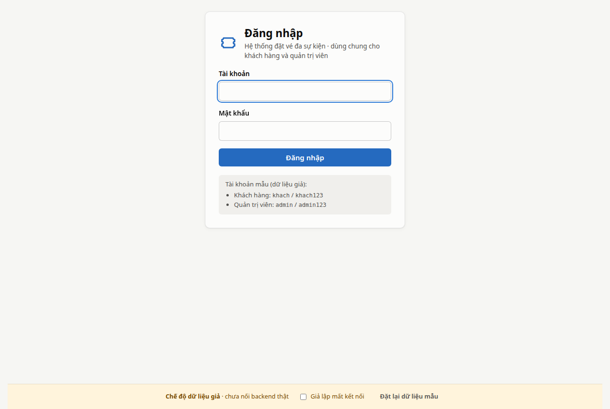 Đăng nhập | 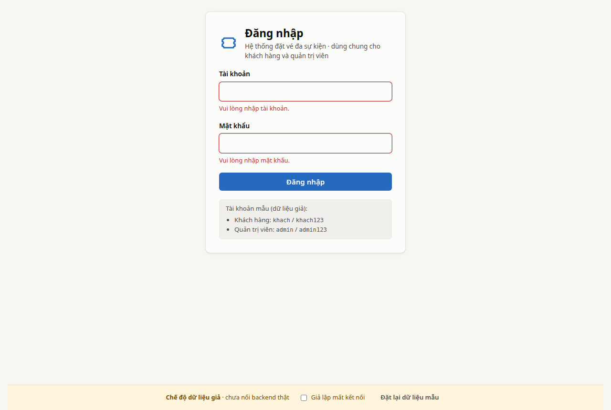 Báo lỗi khi bỏ trống |
| 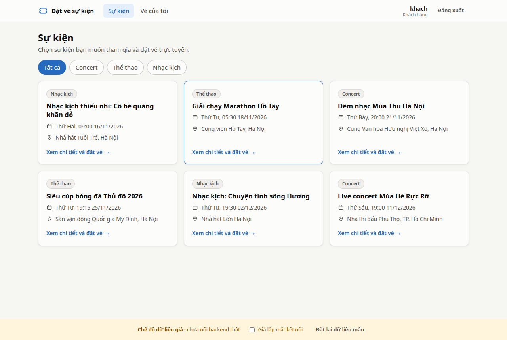 Danh sách sự kiện | 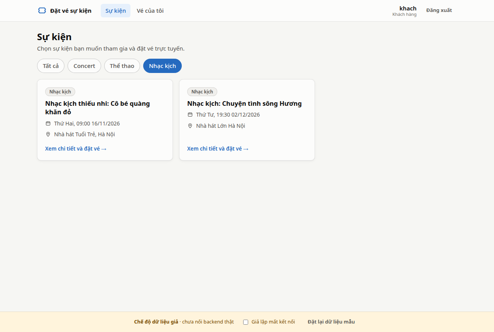 Lọc theo loại hình |
| 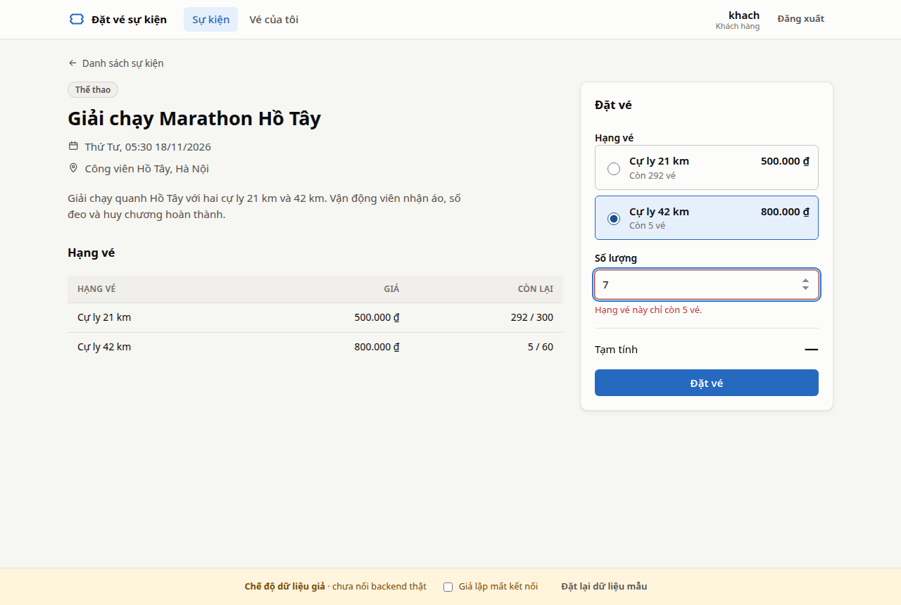 Số lượng vượt số vé còn lại | 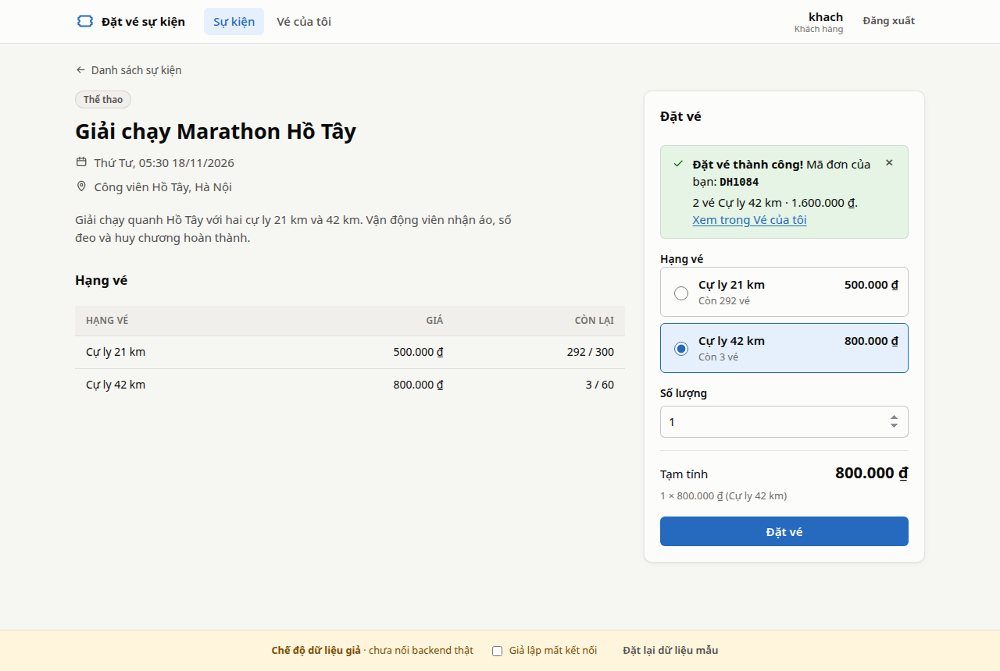 Đặt vé thành công, hiện mã đơn |
| 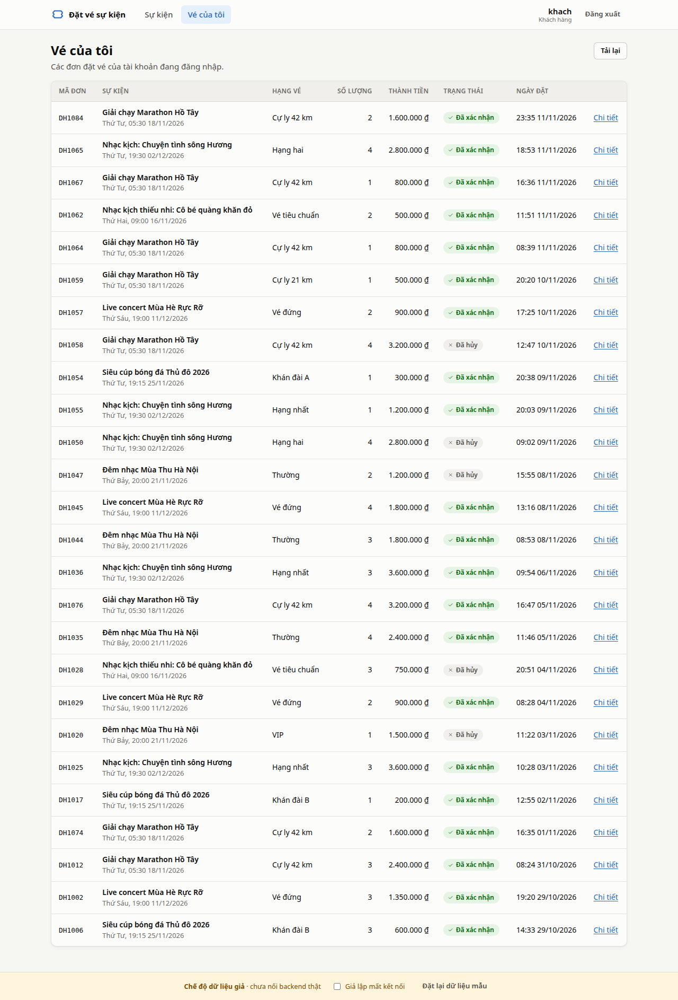 Vé của tôi | 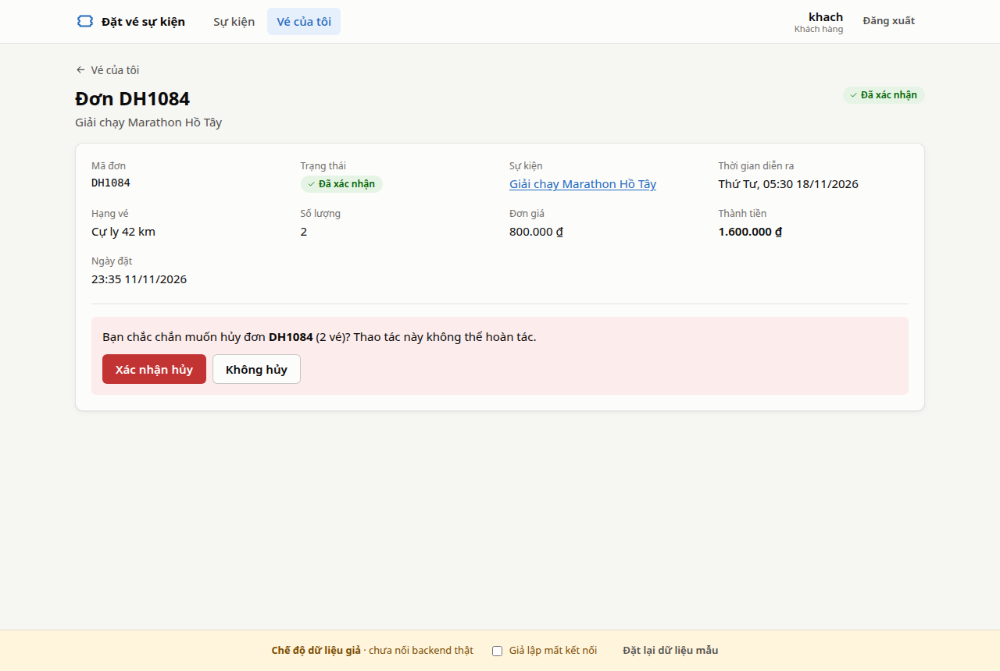 Xác nhận hủy đơn |
| 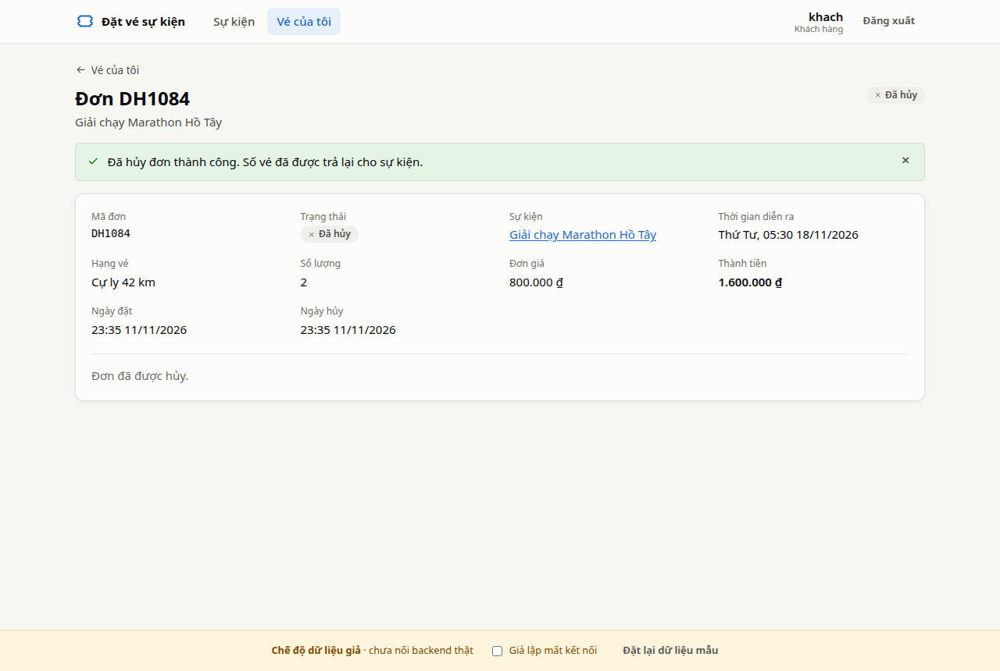 Hủy thành công | 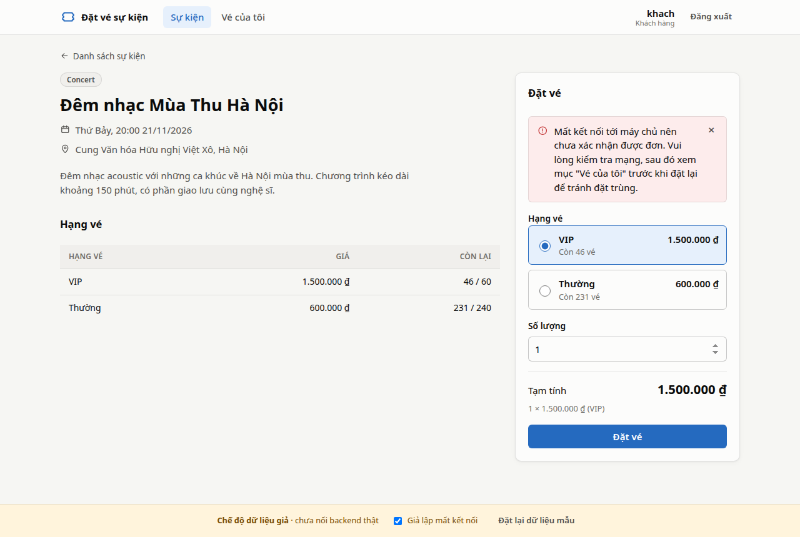 Báo mất kết nối khi đặt vé |
| 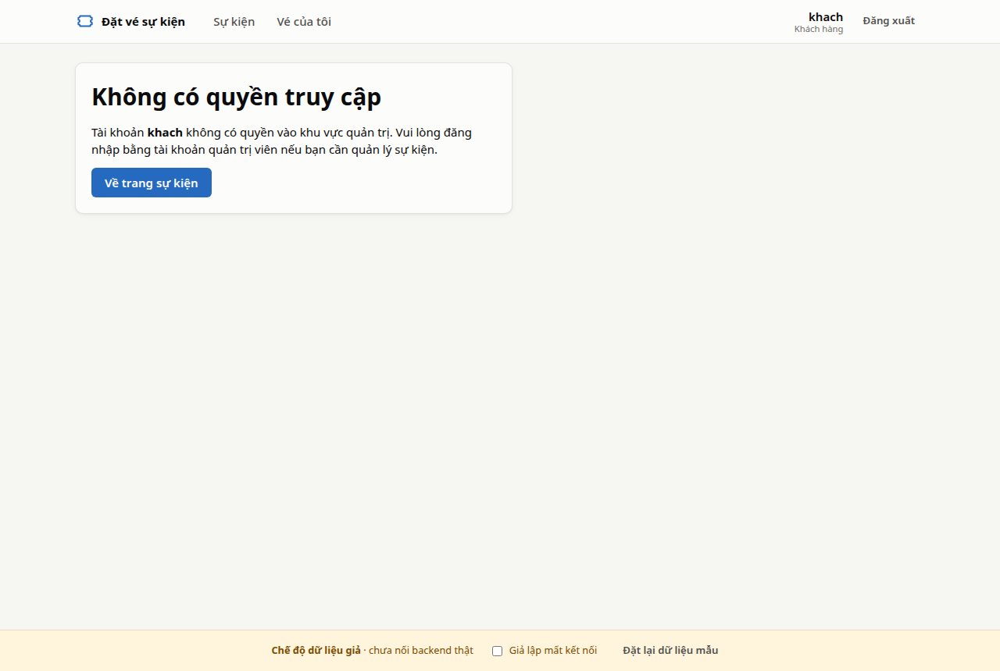 Khách vào khu quản trị | 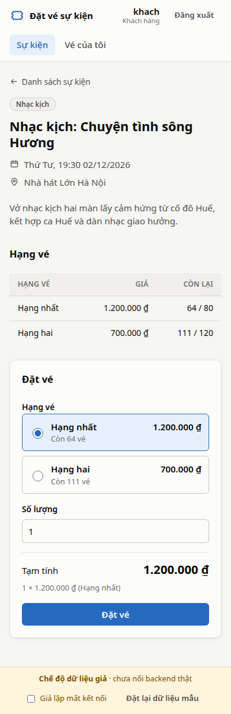 Giao diện điện thoại |

## 5. Hướng dẫn chạy

```bash
cd frontend
npm install
npm run dev        # http://localhost:5173, dữ liệu giả, tài khoản khach / khach123
npm test           # kiểm thử tự động
```

Khi backend đã chạy: sửa `.env.api` rồi `npm run dev:api`. Cách triển khai lên Cloud Run có trong `README.md`.

## 6. Hạn chế và việc còn lại

- **Chưa ghép với backend thật** vì hai backend đang được làm song song. Toàn bộ kiểm thử hiện chạy trên backend giả. Cần làm tiếp: chốt [hợp đồng API](API-CONTRACT.md) với Đoàn Việt Đức và Vũ Ngọc Đức, sau đó chạy lại kịch bản Playwright trên URL thật.
- Điều kiện hủy đơn đang tạm hiểu là "trước khi sự kiện diễn ra"; nếu nhóm chốt điều kiện khác thì backend trả `CANCEL_NOT_ALLOWED` kèm lý do, frontend hiển thị nguyên văn nên không phải sửa code.
- Token đang lưu trong `localStorage` cho đơn giản. Với hệ thống thật nên chuyển sang cookie `HttpOnly` do backend cấp để giảm rủi ro bị đánh cắp qua XSS.
