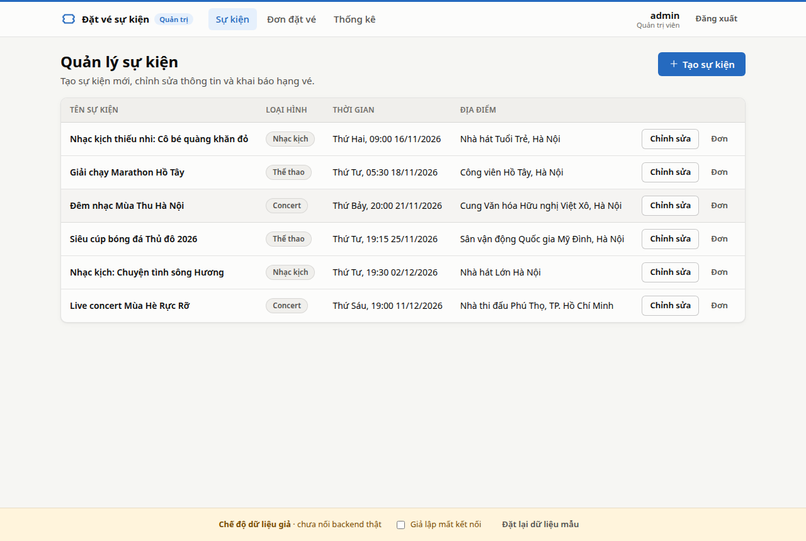
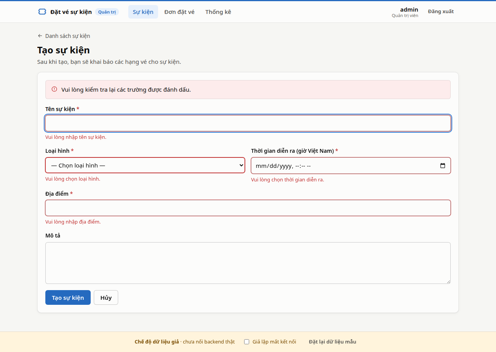
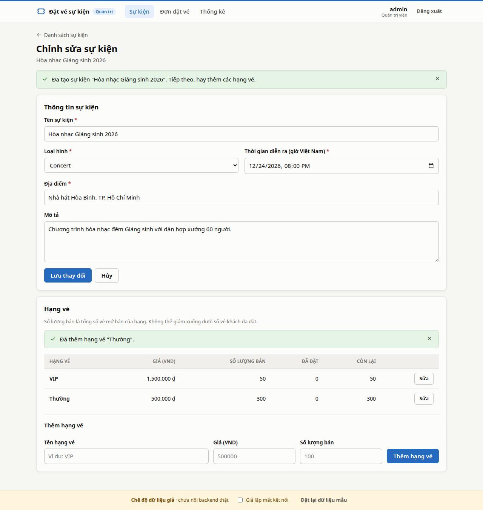
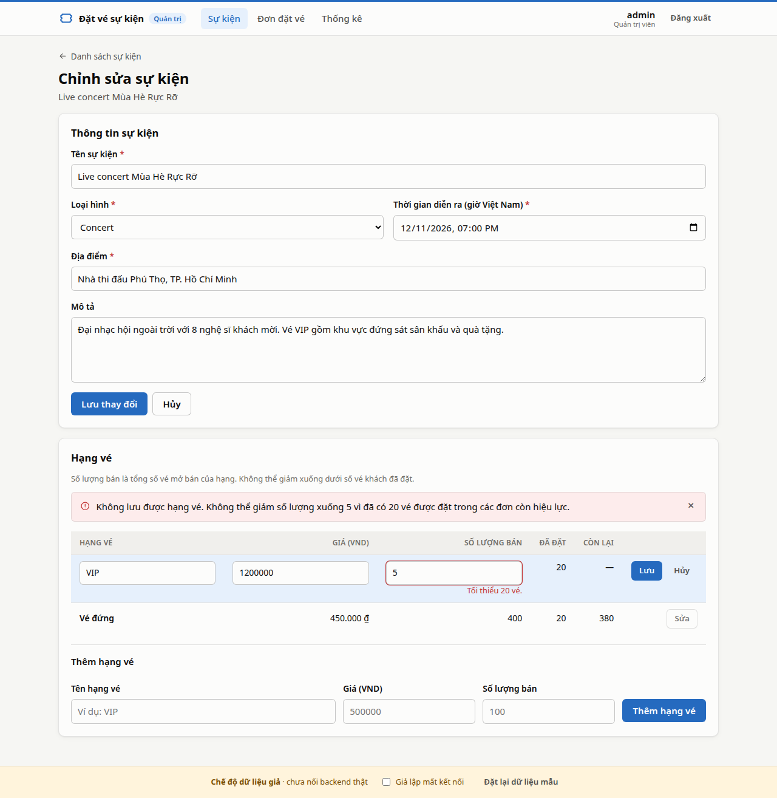
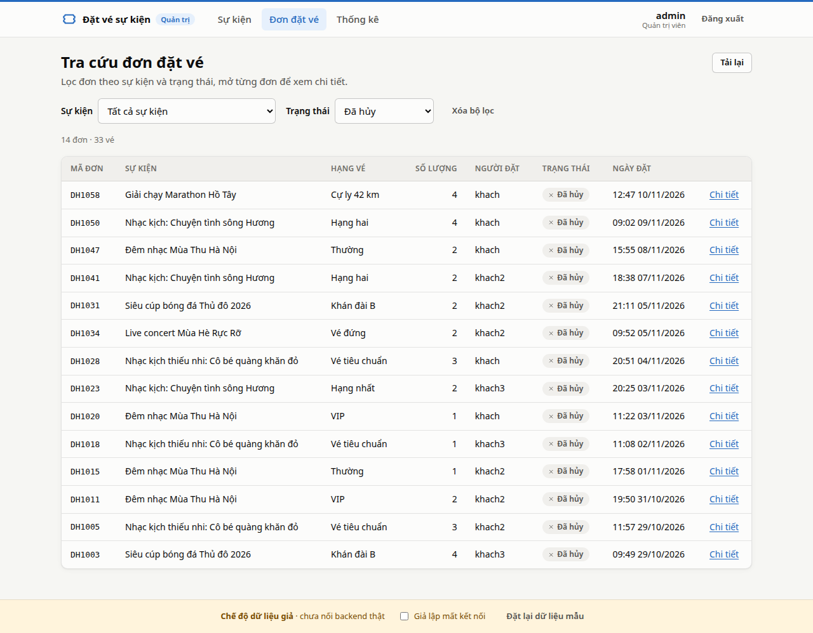
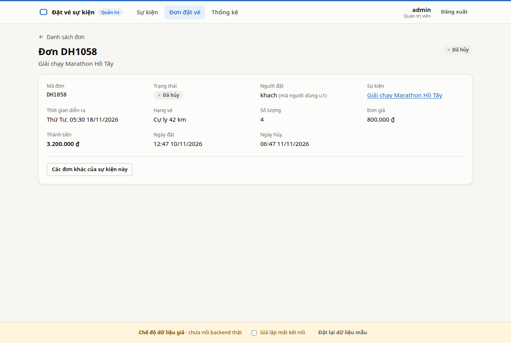
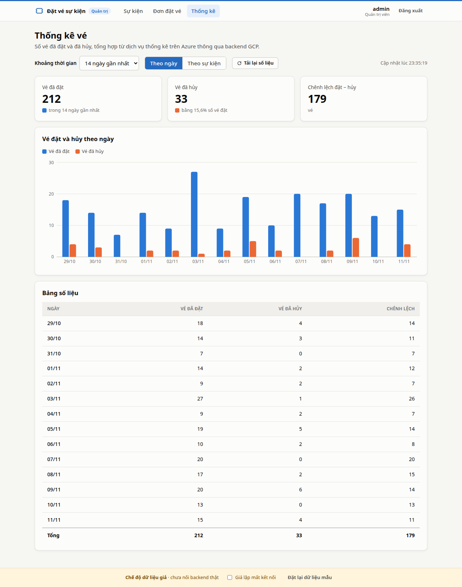
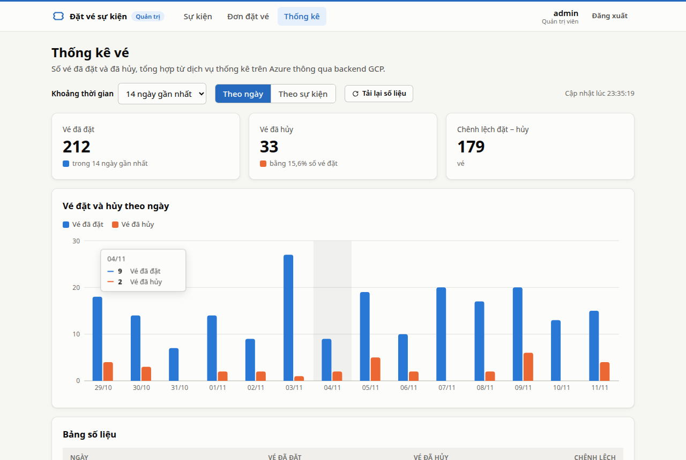
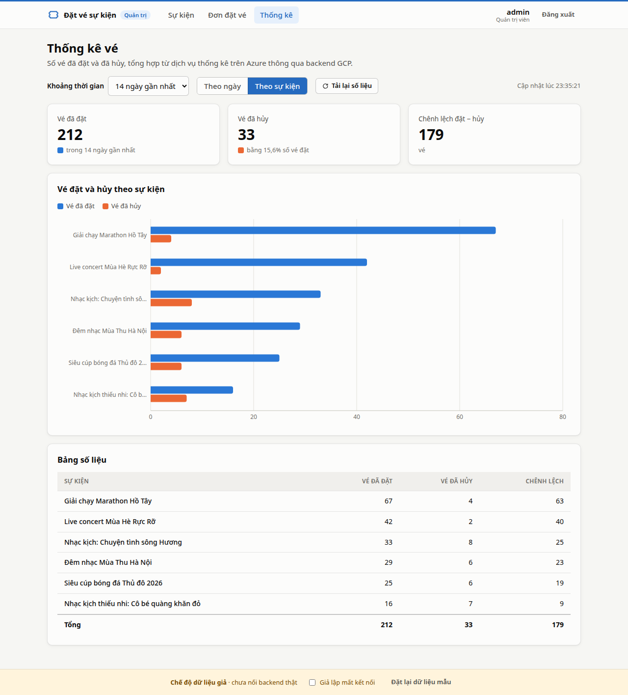
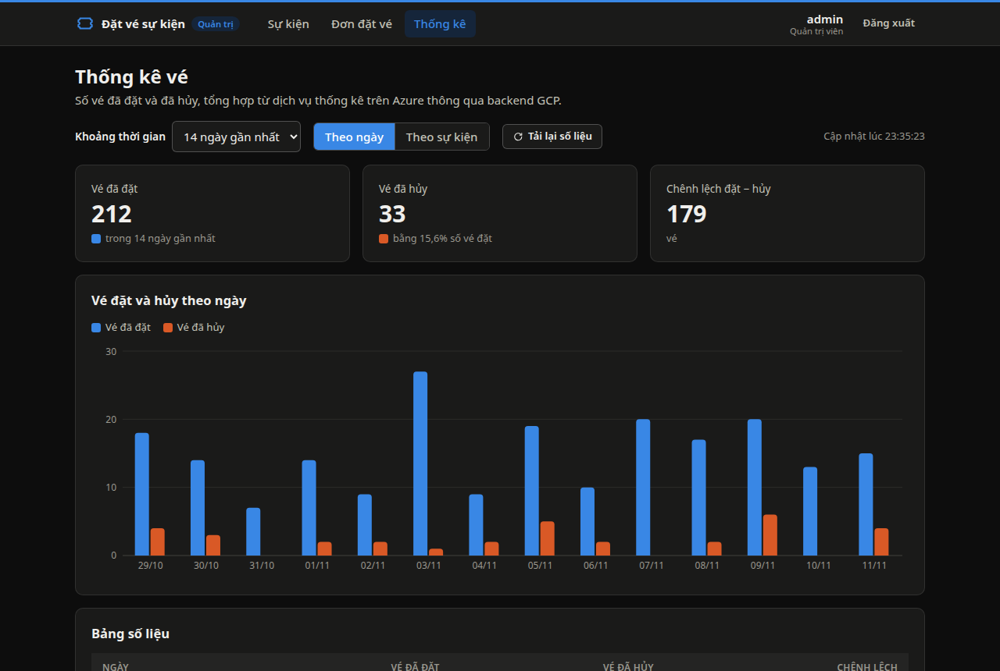

# Báo cáo: Giao diện quản lý sự kiện và vé

| | |
|---|---|
| Đầu việc | 2 — Giao diện quản lý sự kiện và vé (phía quản trị) |
| Người thực hiện | Nguyễn Quang Huy |
| Hệ thống | Hệ thống đặt vé đa sự kiện — Nhóm 5 (GCP + Azure) |
| Mã nguồn | `frontend/src/pages/admin/`, dùng chung `src/api`, `src/auth`, `src/components`, `src/lib` với giao diện khách hàng |

## 1. Mục tiêu

Xây dựng khu vực quản trị để quản trị viên tạo và sửa sự kiện, khai báo hạng vé, tra cứu đơn đặt vé và xem thống kê số vé đặt/hủy. Số liệu thống kê do dịch vụ trên Azure (Trương Gia Sinh) tổng hợp, frontend lấy qua backend GCP.

## 2. Công nghệ và cách tổ chức

- Cùng một ứng dụng với giao diện khách hàng (**React 18 + TypeScript + Vite**), nằm dưới đường dẫn `/admin`. Hai bên dùng chung màn hình đăng nhập, phiên đăng nhập và lớp gọi API.
- **Recharts** để vẽ biểu đồ. Trang thống kê được tách thành file tải riêng (lazy loading), nên khách hàng không phải tải thư viện biểu đồ (bundle chính 238 KB thay vì 641 KB).
- Màu biểu đồ (xanh = vé đặt, cam = vé hủy) đã được kiểm tra bằng công cụ đo độ tương phản và mô phỏng mù màu, đạt ở cả chế độ sáng và tối.
- Trong lúc backend chưa xong, khu vực quản trị chạy trên backend giả (`src/api/mock/`), trả lời đúng theo [hợp đồng API](API-CONTRACT.md), kể cả các lỗi nghiệp vụ như giảm số vé xuống dưới số đã đặt.

## 3. Chức năng đã làm

| Yêu cầu trong bảng phân công | Cách làm | File |
|---|---|---|
| Dùng phiên đăng nhập chung, vào khu quản trị khi có quyền; báo nếu không có quyền | Đăng nhập bằng tài khoản `admin` được chuyển thẳng tới `/admin`. Tài khoản khách vào `/admin/...` thấy trang "Không có quyền truy cập". Khu quản trị có thanh viền xanh và nhãn "Quản trị" để dễ phân biệt. | `auth/guards.tsx`, `components/Layout.tsx` |
| Danh sách sự kiện: tên, loại hình, thời gian, địa điểm, nút tạo mới và chỉnh sửa | Bảng sự kiện, mỗi dòng có nút "Chỉnh sửa" và "Đơn" (mở tra cứu đơn đã lọc sẵn theo sự kiện). | `admin/AdminEventsPage.tsx` |
| Form tạo sự kiện; báo rõ trường thiếu hoặc không hợp lệ | Kiểm tra trước khi gửi: tên (bắt buộc, ≤ 200 ký tự), loại hình, thời gian (hợp lệ, ở tương lai), địa điểm, mô tả (≤ 2000 ký tự). Lỗi hiện dưới từng ô và con trỏ nhảy tới ô lỗi đầu tiên. Lỗi `details` từ backend cũng hiện đúng dưới ô tương ứng. Thời gian nhập theo giờ Việt Nam. Tạo xong chuyển sang trang sửa để khai báo hạng vé ngay. | `admin/EventForm.tsx`, `admin/AdminEventFormPage.tsx` |
| Form chỉnh sửa điền sẵn dữ liệu; lưu xong cập nhật lại danh sách | Form nạp sẵn dữ liệu từ `GET /api/events/{id}`, gửi `PUT /api/admin/events/{id}`. Lưu thành công thì quay về danh sách (tải lại từ API) kèm thông báo. Sự kiện đã qua vẫn sửa được các trường khác nếu không đổi thời gian. | `admin/AdminEventFormPage.tsx` |
| Quản lý hạng vé: tên, giá, số lượng bán, hiển thị số còn lại | Bảng hạng vé có cột số lượng bán, **đã đặt**, còn lại. Sửa trực tiếp trên dòng; thêm hạng vé mới ở form bên dưới. Kiểm tra giá là số nguyên không âm, số lượng là số nguyên dương. | `admin/TicketTypeManager.tsx` |
| Hiển thị lỗi backend khi cập nhật hạng vé (số vé mới nhỏ hơn số đã đặt) | Frontend **không tự chặn** trường hợp này mà để backend quyết định, vì số vé đã đặt có thể thay đổi bất cứ lúc nào. Lỗi `QUANTITY_BELOW_BOOKED` được hiện nguyên văn ("…đã có 20 vé được đặt…") và ô số lượng được đánh dấu "Tối thiểu 20 vé." | `admin/TicketTypeManager.tsx` |
| Trang tra cứu đơn: mã đơn, sự kiện, hạng vé, số lượng, người đặt, trạng thái | Bảng đơn mới nhất trước, có tổng số đơn và số vé đang hiển thị. | `admin/AdminOrdersPage.tsx` |
| Lọc đơn theo sự kiện và trạng thái; mở chi tiết một đơn | Hai ô lọc gọi lại `GET /api/admin/orders?eventId=&status=`. Bộ lọc lưu trên URL. Trang chi tiết hiển thị đủ thông tin: người đặt, đơn giá, thành tiền, ngày đặt, ngày hủy, link tới sự kiện. | `admin/AdminOrdersPage.tsx`, `admin/AdminOrderDetailPage.tsx` |
| Dashboard số vé đặt và hủy theo ngày hoặc theo sự kiện, bằng bảng và biểu đồ | Chọn khoảng 7/14/30 ngày và nhóm "Theo ngày"/"Theo sự kiện". Ba ô số liệu tổng (vé đặt, vé hủy kèm tỷ lệ, chênh lệch). Biểu đồ cột (theo ngày) hoặc thanh ngang (theo sự kiện, để tên dài vẫn đọc được), có chú thích, trục chia mốc tròn và khung thông tin khi rê chuột. Bảng số liệu bên dưới có dòng tổng. | `admin/AdminDashboardPage.tsx`, `admin/StatsChart.tsx` |
| Gọi API thống kê qua backend GCP; hiển thị đang tải, lỗi; cập nhật khi tải lại | Gọi `GET /api/admin/stats`. Lần đầu: vòng xoay "Đang tải số liệu". Bấm "Tải lại số liệu": giữ số liệu cũ (mờ đi) trong lúc chờ để không nhảy bố cục. Lỗi lần đầu: thông báo lỗi kèm nút "Thử lại". Lỗi khi tải lại: giữ số liệu cũ và hiện cảnh báo. Hiển thị giờ cập nhật số liệu. | `admin/AdminDashboardPage.tsx` |

## 4. Kiểm thử

### 4.1 Kiểm thử tự động (`npm test`)

| Nhóm | Số test | Nội dung chính |
|---|---|---|
| Lớp API — quản trị | 6 | khách gọi API quản trị bị chặn (403); tạo sự kiện, thêm và sửa hạng vé; lỗi từng trường khi dữ liệu sai; không cho giảm vé dưới số đã đặt; lọc đơn; thống kê cộng đúng sau khi khách đặt 2 vé rồi hủy 2 vé |
| Giao diện quản trị | 8 | admin đăng nhập vào khu quản trị; tạo sự kiện (bỏ trống → báo 4 lỗi; nhập đủ → tạo) rồi thêm hạng vé (giá sai → báo lỗi); lỗi backend khi giảm vé; sửa sự kiện và danh sách cập nhật; lọc đơn và mở chi tiết; **luồng đầy đủ tạo sự kiện → khai báo hạng vé → khách đặt → quản trị thấy đơn và thống kê**; tổng trên ô số liệu khớp với bảng; mất kết nối khi tải lại vẫn giữ số liệu cũ |
| Hàm chia mốc trục biểu đồ | 1 | mốc trục luôn là số tròn (0/10/20/30, 0/20/40/60…) |

Kết quả: **toàn bộ 39 test của dự án đều đạt** (gồm cả phần khách hàng).

### 4.2 Kiểm thử trên trình duyệt thật (Playwright + Google Chrome, `npm run e2e`)

- Kịch bản quản trị: đăng nhập admin → tạo sự kiện (thử bỏ trống trước) → thêm hạng VIP và Thường → thử giảm vé VIP của sự kiện đã bán hết xuống 5 (bị từ chối) → lọc đơn đã hủy → xem chi tiết đơn → xem thống kê theo ngày, rê chuột lên cột, chuyển sang theo sự kiện.
- Kịch bản chế độ tối của trang thống kê.
- Đã chạy đạt trên máy phát triển và trên **bản build production đóng gói trong Docker**.

### 4.3 Ảnh chụp màn hình

| | |
|---|---|
|  Quản lý sự kiện |  Báo lỗi các trường còn thiếu |
|  Khai báo hạng vé |  Lỗi backend khi giảm số vé |
|  Tra cứu đơn có bộ lọc |  Chi tiết đơn |
|  Thống kê theo ngày |  Rê chuột xem số liệu |
|  Thống kê theo sự kiện |  Chế độ tối |

## 5. Hướng dẫn chạy

```bash
cd frontend
npm install
npm run dev        # http://localhost:5173, đăng nhập admin / admin123
npm test
```

## 6. Hạn chế và việc còn lại

- **Chưa ghép với backend và Azure thật**; mọi kiểm thử hiện chạy trên backend giả. Cần chốt với Vũ Ngọc Đức và Trương Gia Sinh định dạng `GET /api/admin/stats` (mục 6 của [hợp đồng API](API-CONTRACT.md)), đặc biệt: số vé hủy tính theo ngày hủy, ngày tính theo giờ Việt Nam, và thông điệp gửi lại không được cộng thêm.
- Chưa có xóa sự kiện và xóa hạng vé, vì bảng phân công không yêu cầu và việc xóa khi đã có đơn cần nhóm thống nhất quy tắc trước.
- Danh sách đơn đang tải một lần toàn bộ. Khi số đơn lớn cần thêm phân trang ở cả backend và frontend.
