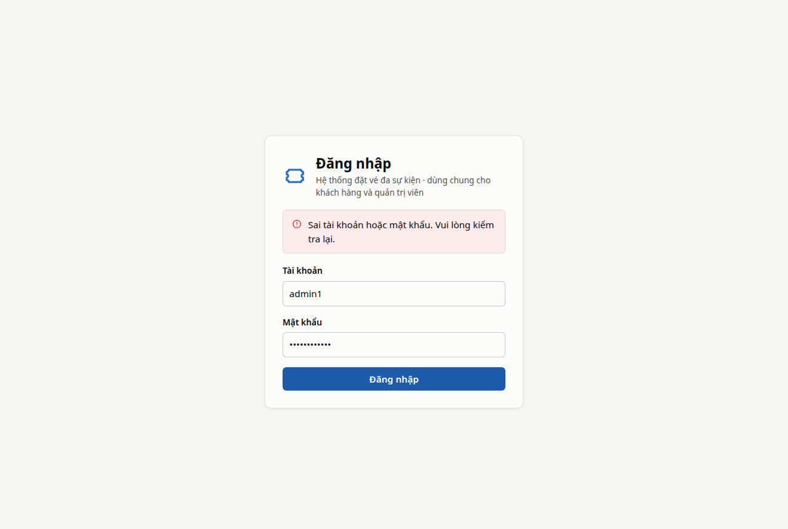
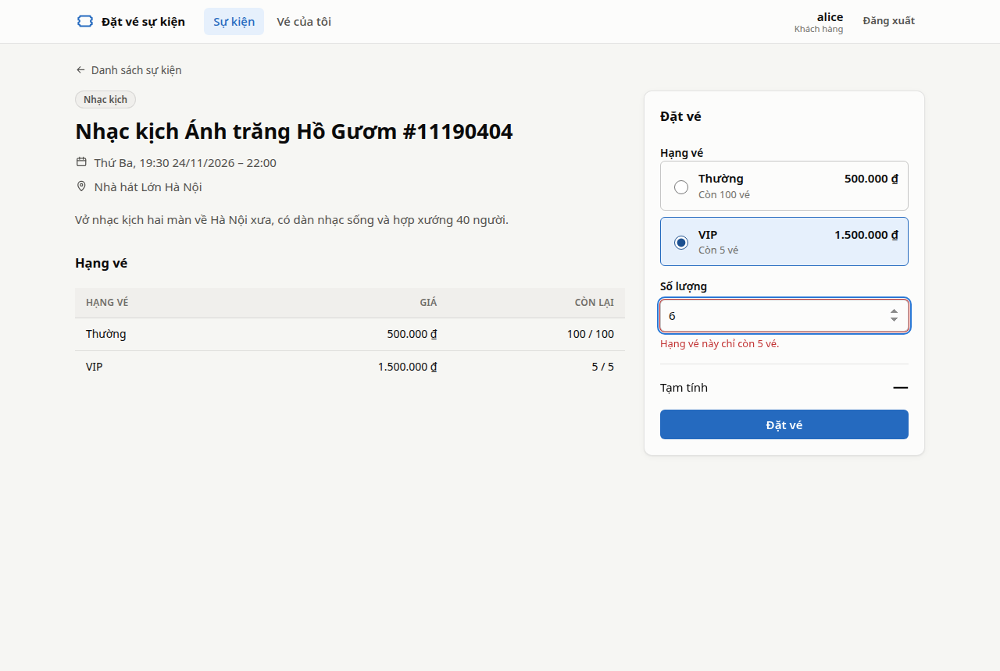
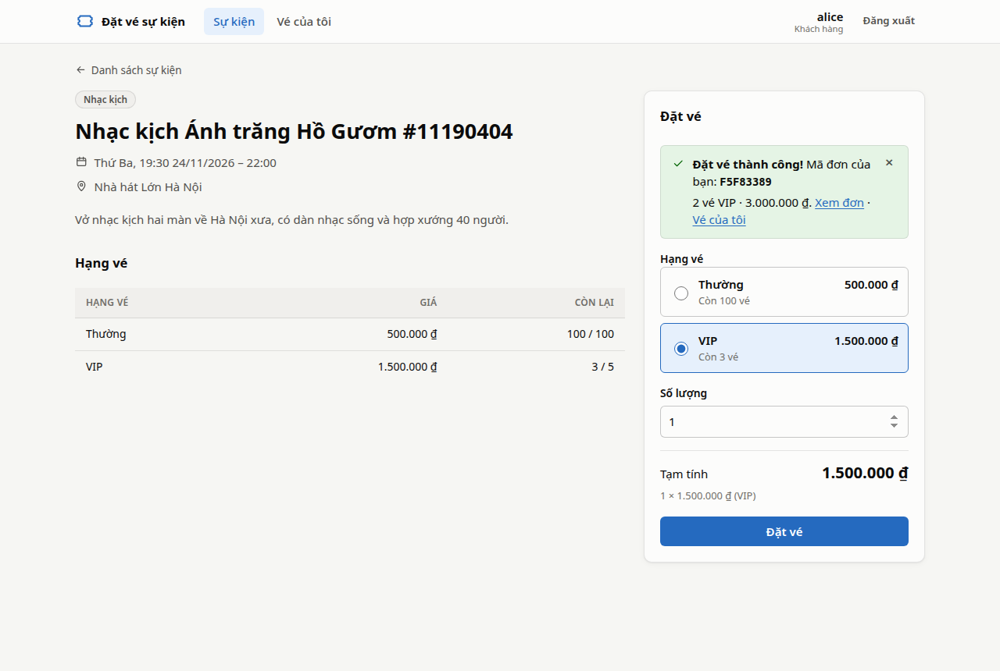
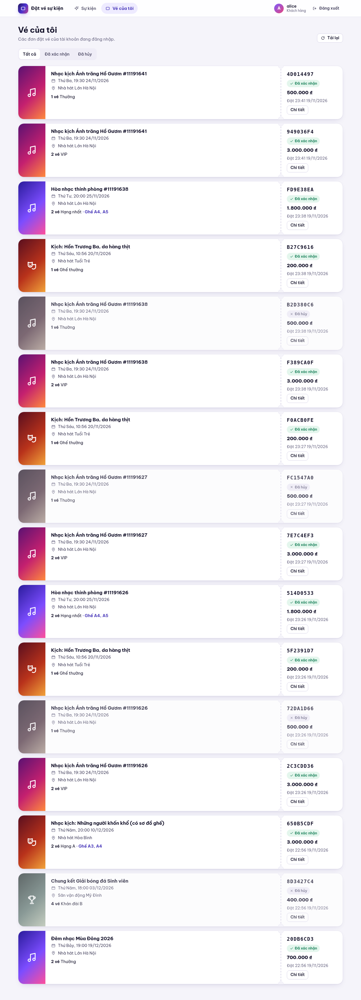
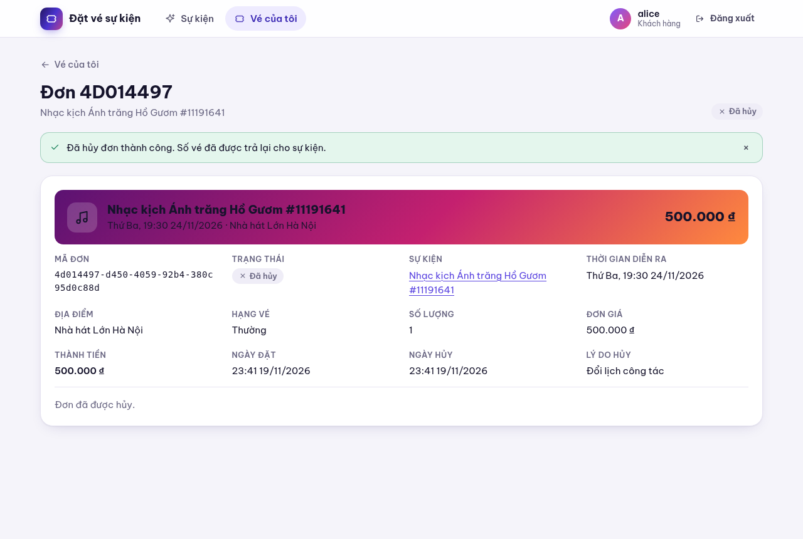

# Báo cáo: Giao diện tìm sự kiện và đặt vé

| | |
|---|---|
| Đầu việc | 1 — Giao diện tìm sự kiện và đặt vé (phía khách hàng) |
| Người thực hiện | Ma Đức Minh |
| Hệ thống | Hệ thống đặt vé đa sự kiện — Nhóm 5 (GCP + Azure) |
| Mã nguồn | `frontend/src/pages/LoginPage.tsx`, `frontend/src/pages/customer/`, phần dùng chung trong `src/api`, `src/auth`, `src/components`, `src/lib` |

## 1. Mục tiêu

Xây dựng các màn hình để khách hàng đăng nhập, xem và lọc sự kiện, đặt vé, theo dõi và hủy đơn của mình. Giao diện gọi API của backend chung trên GCP (thư mục `cloud-backend`): phần đăng nhập và phân quyền của Đoàn Việt Đức, phần sự kiện và đơn của Vũ Ngọc Đức.

## 2. Công nghệ và cách tổ chức

- **React 18 + TypeScript**, đóng gói bằng **Vite**; điều hướng bằng **React Router**. CSS tự viết (`src/styles.css`), hỗ trợ chế độ sáng/tối và màn hình điện thoại.
- **Lớp gọi API** (`src/api/client.ts`, `src/api/index.ts`) gom mọi xử lý chung vào một chỗ: gắn `Authorization: Bearer`, giới hạn thời gian chờ 15 giây, chuyển mọi lỗi về một dạng `ApiError { status, code, message, details }`, tách lỗi theo từng ô nhập từ `details: [{ path, message }]` của backend. Khi máy chủ trả 401, lớp này báo cho phần quản lý phiên để tự đăng xuất.
- **Nối với backend chung**: mọi đường dẫn, dữ liệu và mã lỗi theo [`cloud-backend/docs/API.md`](../../cloud-backend/docs/API.md). Khi phát triển, dev server của Vite chuyển tiếp `/api` sang backend nên không vướng CORS. Chi tiết: [KET-NOI-BACKEND.md](KET-NOI-BACKEND.md).
- **Backend giả** (`src/api/mock/`): trước khi có backend, nhóm frontend viết một backend giả chạy trong trình duyệt. Khi backend thật xong, backend giả được viết lại theo đúng hợp đồng của backend thật (cùng đường dẫn, dữ liệu, mã lỗi, tài khoản mẫu), để vẫn chạy demo và kiểm thử nhanh được khi không bật backend.

```text
Trình duyệt ──► Frontend ──/api──► Backend chung (Express, Cloud Run) ──► PostgreSQL (Cloud SQL)
                                          └──► Azure (hàng đợi và API thống kê)
```

## 3. Chức năng đã làm

| Yêu cầu trong bảng phân công | Cách làm | API backend |
|---|---|---|
| Trang đăng nhập: ô tài khoản, mật khẩu, nút đăng nhập; báo lỗi khi thiếu hoặc sai | Kiểm tra ô trống trước khi gửi (báo lỗi ngay dưới ô). Sai tài khoản hoặc mật khẩu thì báo lỗi chung, không nói rõ sai ô nào. Nút bị khóa trong lúc chờ. | `POST /api/auth/login` |
| Lưu phiên, chuyển khách tới trang sự kiện; dùng chung cho quản trị viên | Lưu token trong `sessionStorage` theo hướng dẫn của backend. Tải lại trang thì gọi `GET /api/me` để lấy vai trò mới nhất. Sau đăng nhập: `customer` vào `/events`, `admin` vào `/admin`. Bị chặn ở trang nào thì đăng nhập xong quay lại đúng trang đó. | `GET /api/me` |
| Danh sách sự kiện: tên, loại hình, thời gian, địa điểm | Lưới thẻ sự kiện, ngày giờ theo giờ Việt Nam kèm thứ trong tuần. Thêm giá thấp nhất và số vé còn (hoặc "Hết vé"). Có phân trang. | `GET /api/events` |
| Bộ lọc concert / thể thao / nhạc kịch, đổi bộ lọc thì gọi API | Nút lọc lấy từ các loại hình đang có sự kiện mở bán, kèm tên tiếng Việt (`sport` → Thể thao, `musical` → Nhạc kịch, …). Đổi bộ lọc thì gọi lại API. Bộ lọc lưu trên URL nên tải lại trang hoặc gửi link vẫn giữ. | `GET /api/events/categories`, `GET /api/events?category=` |
| Trang chi tiết: mô tả, thời gian, địa điểm, hạng vé với giá và số còn lại | Hiện giờ bắt đầu và kết thúc. Bảng hạng vé ghi "còn / tổng" hoặc "Hết vé". | `GET /api/events/:id` |
| Form đặt vé: chọn hạng, số lượng nguyên dương, thành tiền tạm tính | Hạng hết vé bị khóa. Số lượng phải là số nguyên dương và không vượt số còn lại. Thành tiền cập nhật ngay khi đổi hạng hoặc số lượng. | |
| Bấm đặt: khóa nút khi chờ; hiện mã đơn khi thành công; báo rõ khi hết vé hoặc mất kết nối | Nút đổi thành "Đang đặt vé…" và bị khóa. Thành công: hiện mã đơn, số vé, thành tiền, link tới đơn; số vé còn lại được tải lại. Hết vé (`SOLD_OUT`) hoặc không đủ (`INSUFFICIENT_TICKETS`): báo số vé còn lại. Vượt 10 vé mỗi đơn: hiện nguyên văn câu của backend. **Mất kết nối**: mỗi lần bấm kèm một `Idempotency-Key`; khi khách bấm lại cùng hạng và số lượng, frontend gửi lại đúng khóa đó nên backend trả về đơn đã tạo, **không tạo đơn trùng**. | `POST /api/orders` |
| Trang Vé của tôi: sự kiện, hạng vé, số lượng, mã đơn, trạng thái | Bảng đơn của tài khoản hiện tại, mới nhất trước, có lọc theo trạng thái và phân trang. Mã đơn là UUID nên hiện 8 ký tự đầu, xem đủ ở trang chi tiết. | `GET /api/orders` |
| Xem chi tiết đơn và yêu cầu hủy; cập nhật trạng thái sau khi API xác nhận | Hiện đủ thông tin đơn và **hạn hủy** (backend chỉ cho hủy trước giờ diễn ít nhất 24 giờ). Nút hủy chỉ hiện khi backend báo `canCancel`. Bấm hủy → hộp xác nhận, nhập lý do (không bắt buộc) → gọi API. **Chỉ đổi trạng thái trên màn hình sau khi API trả thành công.** Quá hạn: "Đã quá hạn hủy đơn (chỉ được hủy đến …)". Đơn bị quản trị viên hủy thì ghi rõ người hủy và lý do. Đơn của người khác: "Không tìm thấy đơn". | `GET /api/orders/:id`, `POST /api/orders/:id/cancel` |
| Kiểm tra màn hình khi đang tải, không có dữ liệu, API lỗi | Mọi màn hình có ba trạng thái: đang tải, rỗng (kèm gợi ý), lỗi (kèm nút "Thử lại"). Phiên hết hạn thì tự đăng xuất và báo cho người dùng. | |

Ngoài yêu cầu: giao diện điện thoại, chế độ tối, điều hướng bằng bàn phím và nhãn cho trình đọc màn hình, trang "Không có quyền" khi khách vào khu quản trị.

## 4. Kiểm thử

### 4.1 Kiểm thử trên trình duyệt thật với backend thật (`npm run e2e:api`)

Chạy Playwright trên Google Chrome. Frontend gọi backend chung chạy trên máy (Node.js + PostgreSQL 16 trong Docker, `AUTH_MODE=local`, tài khoản mẫu `alice`, `bob`, `admin1`). Kịch bản tự tạo sự kiện riêng nên chạy lại bao nhiêu lần cũng được.

| Kịch bản | Nội dung | Kết quả |
|---|---|---|
| 1 | Đăng nhập bỏ trống, sai mật khẩu; quản trị viên tạo sự kiện nhạc kịch, thêm hạng VIP (5 vé) và Thường | Đạt |
| 2 | `alice` lọc "Nhạc kịch" → mở sự kiện → nhập 6 vé VIP (bị báo chỉ còn 5) → đặt 2 vé, thấy mã đơn và số còn lại giảm còn 3 → đặt 1 vé Thường nhưng **phản hồi bị chặn sau khi máy chủ đã tạo đơn**, bấm lại → "Vé của tôi" chỉ có 2 đơn, không trùng | Đạt |
| 3 | Hủy đơn kèm lý do; đặt vé vở kịch diễn trong vòng 24 giờ tới → đơn hiện "Đã quá hạn hủy"; vào trang quản trị bị chặn; `bob` mở đường dẫn đơn của `alice` → "Không tìm thấy" | Đạt |
| 4 | Phần quản trị (xem báo cáo của Nguyễn Quang Huy) | Đạt |
| 5 | Màn hình điện thoại 390 px (không có thanh cuộn ngang) và chế độ tối | Đạt |

Cùng bộ kịch bản cũng đạt khi chạy với backend giả (`npm run e2e`).

### 4.2 Kiểm thử tự động (Vitest + Testing Library, `npm test`)

Chạy trên backend giả, mô phỏng người dùng bấm và gõ thật. Toàn bộ **50 test đều đạt** (gồm cả phần quản trị).

| Nhóm | Số test | Nội dung chính |
|---|---|---|
| Lớp API — đăng nhập | 6 | đúng/sai mật khẩu, bỏ trống, `/api/me`, token sai → tự đăng xuất, chưa đăng nhập gọi API cần xác thực |
| Lớp API — sự kiện | 4 | phân trang, ẩn bản nháp, lọc theo loại, danh sách loại hình, 404 |
| Lớp API — đặt/hủy | 7 | trừ và hoàn vé đúng một lần, `Idempotency-Key`, hết vé, vượt số còn lại, vượt 10 vé/đơn, số lượng 0 hoặc 1,5, quá hạn hủy, đơn của người khác, mất mạng |
| Giao diện khách hàng | 14 | luồng đầy đủ đăng nhập → lọc → đặt → Vé của tôi → hủy kèm lý do; khóa nút khi chờ; hạng hết vé; lỗi vượt số vé/đơn; rớt mạng rồi bấm lại không trùng đơn; quá hạn hủy; lỗi tải và nút Thử lại; danh sách rỗng; chuyển trang; phiên hết hạn; khách vào trang quản trị |

### 4.3 Ảnh chụp màn hình (chạy với backend thật)

| | |
|---|---|
|  Đăng nhập |  Sai mật khẩu |
|  Danh sách sự kiện, nút lọc lấy từ backend |  Lọc "Nhạc kịch" |
|  Số lượng vượt số vé còn lại |  Đặt vé thành công, hiện mã đơn |
|  Báo mất kết nối khi đặt vé |  Vé của tôi |
|  Xác nhận hủy, nhập lý do |  Hủy thành công |
|  Đơn quá hạn hủy |  Mở đơn của người khác |
|  Khách vào khu quản trị |  Giao diện điện thoại |

## 5. Hướng dẫn chạy

```bash
# Backend (thư mục cloud-backend): xem mục 3.2 của README chung, cần AUTH_MODE=local
cd frontend
npm install
npm run dev:api    # http://localhost:5173, tài khoản alice / DemoCustomer2026!
npm test           # kiểm thử tự động
npm run e2e:api    # kịch bản trên Chrome với backend thật
```

Không bật backend thì dùng `npm run dev` (dữ liệu giả, cùng tài khoản).

## 6. Hạn chế và việc còn lại

- **Chưa chạy trên cloud.** Frontend đã nối và kiểm thử với bản backend mới nhất chạy trên máy. Bản `ticket-api` đang chạy trên Cloud Run là bản cũ với `AUTH_MODE=jwt`, chưa có API đăng nhập. Cần Hoàng Quốc Dương triển khai lại backend với `AUTH_MODE=local` và tài khoản mẫu, sau đó triển khai frontend (mục 5 của [KET-NOI-BACKEND.md](KET-NOI-BACKEND.md)).
- Thống kê trên máy dùng `STATS_MODE=mock` (backend tự tính từ DB), chưa thử với API thống kê thật trên Azure.
- Token lưu trong `sessionStorage` nên vẫn có thể bị đọc nếu trang dính lỗi XSS. Hệ thống thật nên chuyển sang cookie `HttpOnly` do backend cấp.
