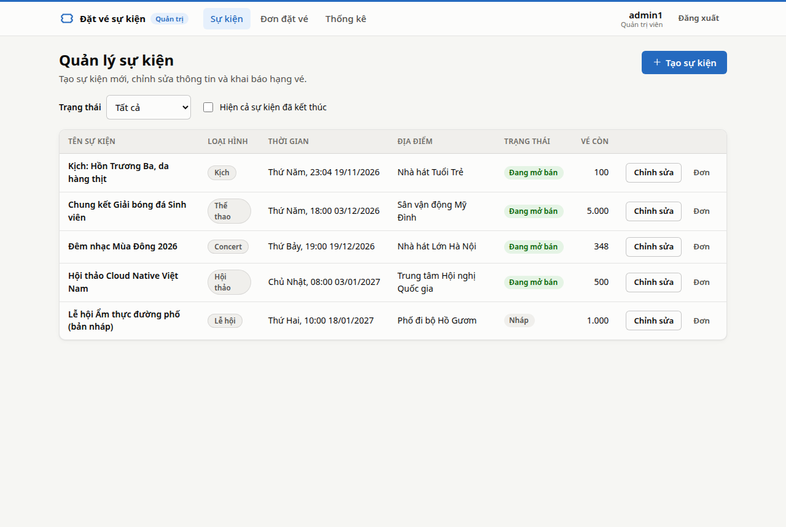
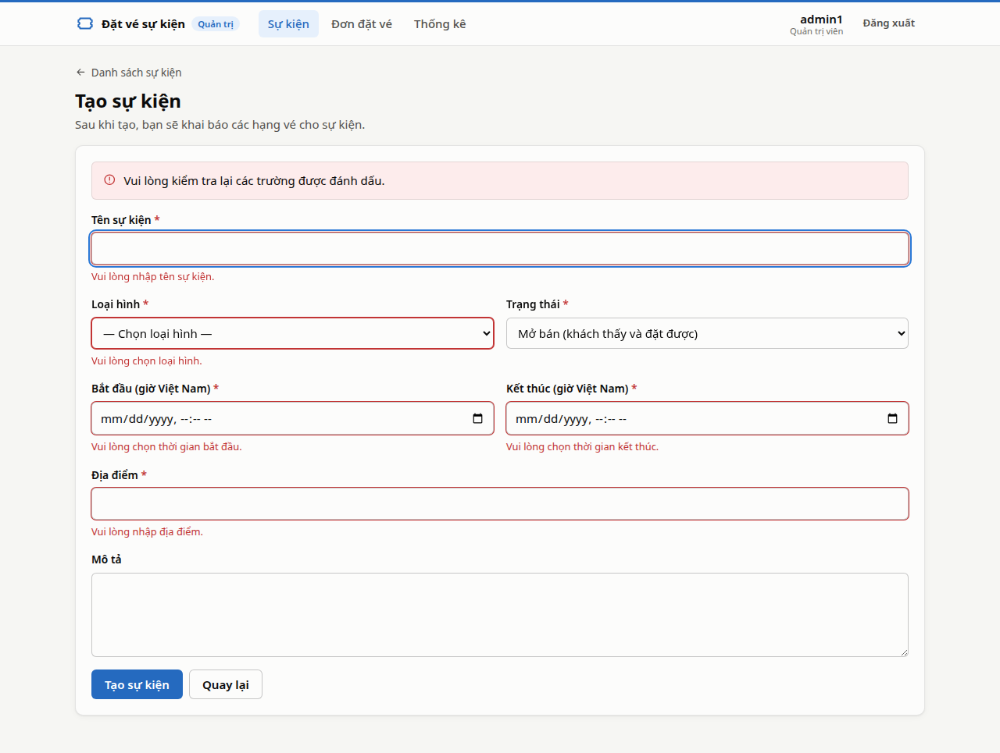
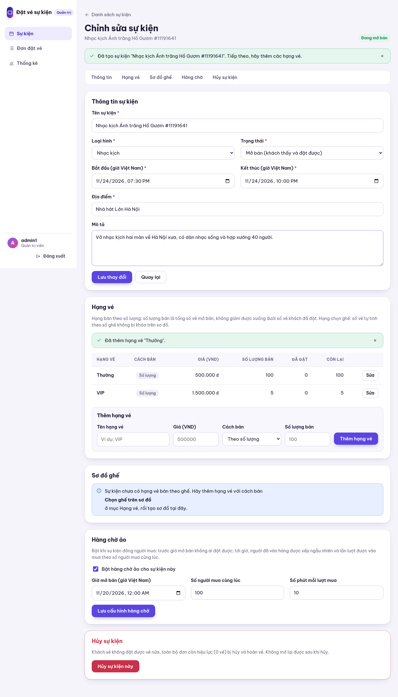
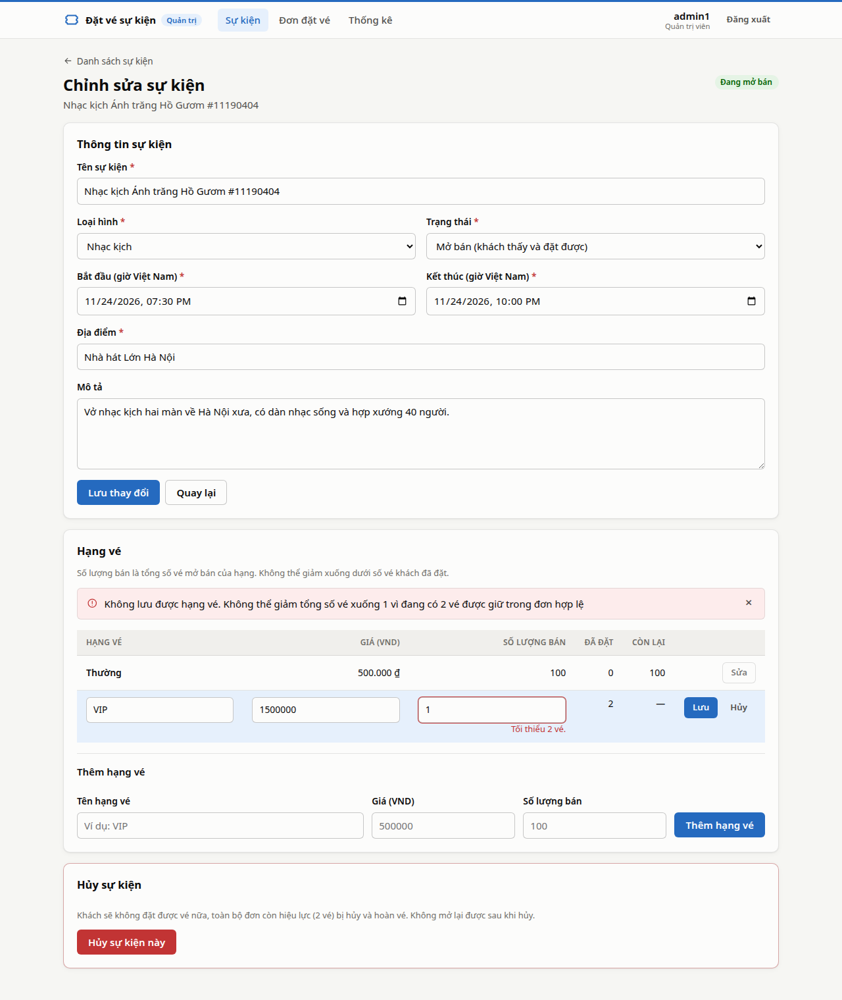
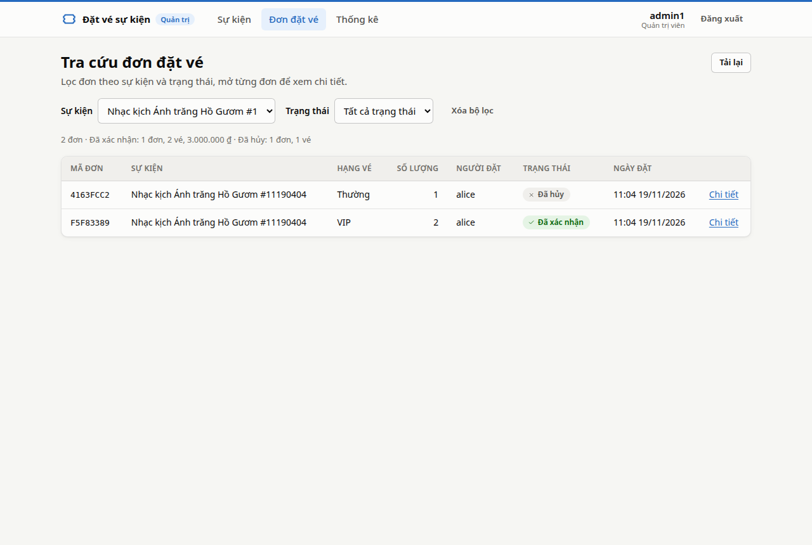
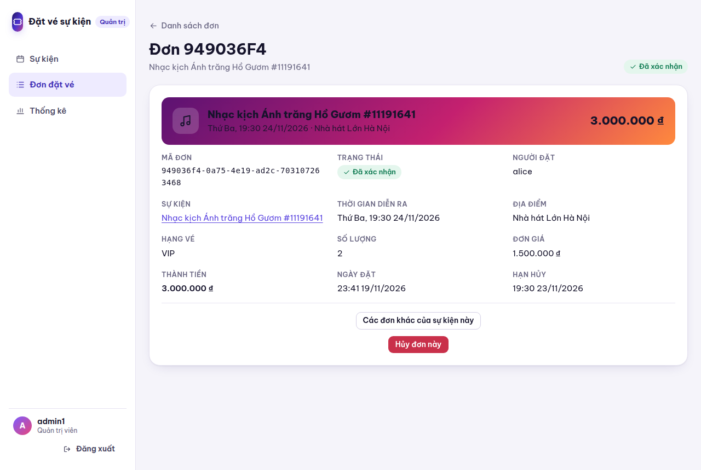
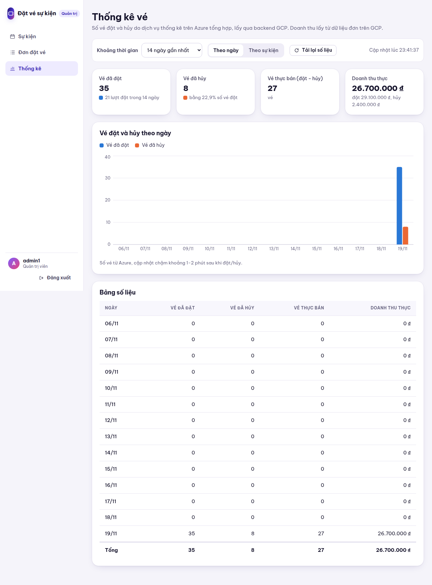
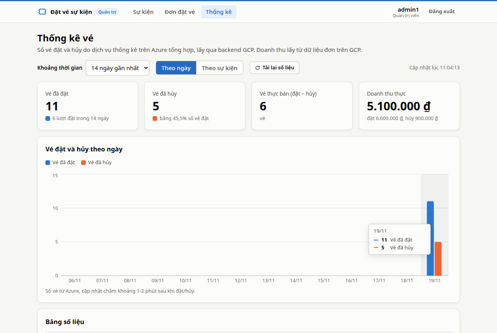
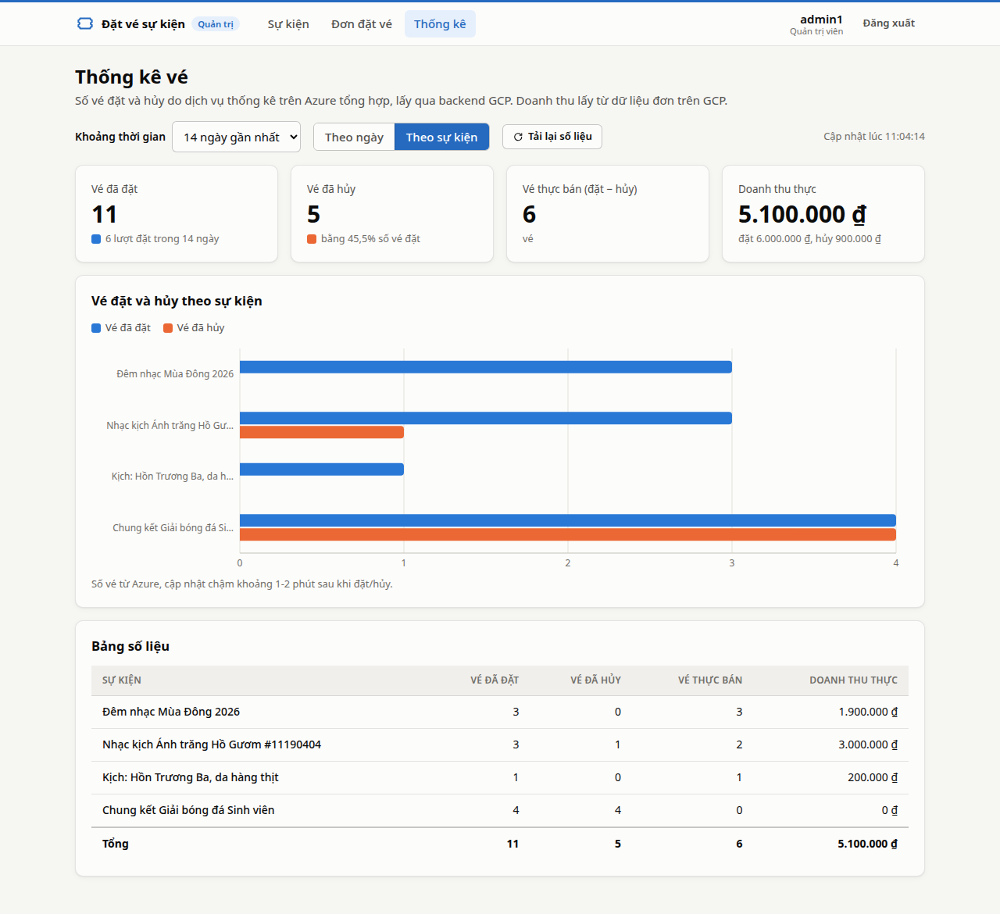
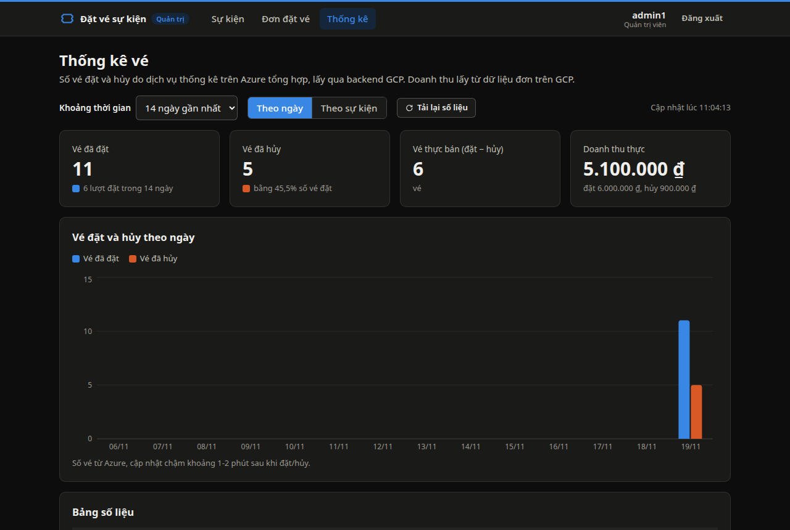

# Báo cáo: Giao diện quản lý sự kiện và vé

| | |
|---|---|
| Đầu việc | 2 — Giao diện quản lý sự kiện và vé (phía quản trị) |
| Người thực hiện | Nguyễn Quang Huy |
| Hệ thống | Hệ thống đặt vé đa sự kiện — Nhóm 5 (GCP + Azure) |
| Mã nguồn | `frontend/src/pages/admin/`, dùng chung `src/api`, `src/auth`, `src/components`, `src/lib` với giao diện khách hàng |

## 1. Mục tiêu

Xây dựng khu vực quản trị để quản trị viên tạo và sửa sự kiện, khai báo hạng vé, tra cứu đơn đặt vé và xem thống kê số vé đặt/hủy. Số vé do dịch vụ thống kê trên Azure (Trương Gia Sinh) tổng hợp; frontend lấy qua backend chung trên GCP (Vũ Ngọc Đức), backend ghép thêm doanh thu từ dữ liệu đơn.

## 2. Công nghệ và cách tổ chức

- Cùng một ứng dụng với giao diện khách hàng (**React 18 + TypeScript + Vite**), nằm dưới đường dẫn `/admin`. Hai bên dùng chung màn hình đăng nhập, phiên đăng nhập và lớp gọi API.
- Nối với backend chung theo [`cloud-backend/docs/API.md`](../../cloud-backend/docs/API.md). Danh sách API dùng ở từng màn hình và cách xử lý từng mã lỗi: [KET-NOI-BACKEND.md](KET-NOI-BACKEND.md).
- **Recharts** để vẽ biểu đồ. Trang thống kê được tách thành file tải riêng, nên khách hàng không phải tải thư viện biểu đồ.
- Màu biểu đồ (xanh = vé đặt, cam = vé hủy) đã kiểm tra bằng công cụ đo độ tương phản và mô phỏng mù màu, đạt ở cả chế độ sáng và tối.

## 3. Chức năng đã làm

| Yêu cầu trong bảng phân công | Cách làm | API backend |
|---|---|---|
| Dùng phiên đăng nhập chung, vào khu quản trị khi có quyền; báo nếu không có quyền | Tài khoản `admin` đăng nhập được chuyển thẳng tới `/admin`. Tài khoản khách vào `/admin/...` thấy trang "Không có quyền truy cập". Backend cũng chặn ở phía máy chủ (khách gọi API quản trị nhận 403). | `POST /api/auth/login`, `GET /api/me` |
| Danh sách sự kiện: tên, loại hình, thời gian, địa điểm, nút tạo mới và chỉnh sửa | Bảng sự kiện ở mọi trạng thái (mở bán, nháp, đã hủy), thêm cột trạng thái và số vé còn. Lọc theo trạng thái, tùy chọn hiện cả sự kiện đã kết thúc, phân trang. Mỗi dòng có nút "Chỉnh sửa" và "Đơn". | `GET /api/admin/events` |
| Form tạo sự kiện; báo rõ trường thiếu hoặc không hợp lệ | Các trường: tên, loại hình, trạng thái (mở bán hoặc nháp), giờ bắt đầu, giờ kết thúc, địa điểm, mô tả. Kiểm tra trước khi gửi: bắt buộc, độ dài, giờ bắt đầu ở tương lai, giờ kết thúc sau giờ bắt đầu. Lỗi hiện dưới từng ô, con trỏ nhảy tới ô lỗi đầu tiên. Lỗi theo trường từ backend (`details: [{ path, message }]`) cũng hiện dưới đúng ô. Tạo xong chuyển sang trang sửa để khai báo hạng vé. | `POST /api/admin/events` |
| Form chỉnh sửa điền sẵn dữ liệu; lưu xong cập nhật lại danh sách | Form nạp sẵn dữ liệu (kể cả sự kiện nháp). Lưu thì **chỉ gửi các trường đã đổi** bằng `PATCH`; không đổi gì thì báo "Bạn chưa thay đổi thông tin nào". Lưu xong quay về danh sách đã tải lại. | `GET` và `PATCH /api/admin/events/:id` |
| Quản lý hạng vé: tên, giá, số lượng bán, hiển thị số còn lại | Bảng hạng vé có cột số lượng bán, **đã đặt** và còn lại. Sửa trực tiếp trên dòng (chỉ gửi trường đã đổi); thêm hạng vé mới ở form bên dưới. Trùng tên hạng vé: báo dưới ô tên. | `POST /api/admin/events/:id/ticket-types`, `PATCH /api/admin/ticket-types/:id` |
| Hiển thị lỗi backend khi cập nhật hạng vé (số vé mới nhỏ hơn số đã đặt) | Frontend **không tự chặn** trường hợp này mà để backend quyết định, vì số vé đã đặt có thể thay đổi bất cứ lúc nào. Lỗi `QUANTITY_BELOW_RESERVED` được hiện nguyên văn ("…đang có 2 vé được giữ trong đơn hợp lệ") và ô số lượng ghi "Tối thiểu 2 vé." | `PATCH /api/admin/ticket-types/:id` |
| Trang tra cứu đơn: mã đơn, sự kiện, hạng vé, số lượng, người đặt, trạng thái | Bảng đơn mới nhất trước, có phân trang. Dòng tổng hợp lấy từ `summary` của backend: số đơn, số vé, số tiền theo từng trạng thái. | `GET /api/admin/orders` |
| Lọc đơn theo sự kiện và trạng thái; mở chi tiết một đơn | Hai ô lọc gọi lại API. Bộ lọc lưu trên URL. Trang chi tiết có người đặt, đơn giá, thành tiền, ngày đặt, hạn hủy, ngày hủy, người hủy, lý do hủy, link tới sự kiện. | `GET /api/admin/orders/:id` |
| Dashboard số vé đặt và hủy theo ngày hoặc theo sự kiện, bằng bảng và biểu đồ | Chọn khoảng 7/14/30/90 ngày và nhóm "Theo ngày" hoặc "Theo sự kiện". Bốn ô số liệu: vé đặt, vé hủy (kèm tỷ lệ), vé thực bán, doanh thu thực. Biểu đồ cột (theo ngày) hoặc thanh ngang (theo sự kiện), có chú thích, trục chia mốc tròn, khung số liệu khi rê chuột. Bảng số liệu có dòng tổng. | `GET /api/admin/stats/daily`, `GET /api/admin/stats/events` |
| Gọi API thống kê qua backend GCP; hiển thị đang tải, lỗi; cập nhật khi tải lại | Lần đầu: "Đang tải số liệu" (có ghi chú Azure có thể khởi động chậm). Bấm "Tải lại số liệu": giữ số liệu cũ (mờ đi) trong lúc chờ. Lỗi lần đầu: thông báo kèm nút "Thử lại". Lỗi khi tải lại: giữ số liệu cũ và cảnh báo. Backend trả `stale: true` (Azure lỗi, dùng bản lưu tạm): hiện cảnh báo kèm giờ của số liệu. | như trên |

Thêm ngoài bảng phân công, vì backend đã hỗ trợ:

- **Hủy cả sự kiện** (mục cuối trang sửa sự kiện): nhập lý do, xác nhận. Backend hủy mọi đơn còn hiệu lực, hoàn vé và báo sang Azure trong một giao dịch; giao diện báo số đơn đã hủy và khóa form của sự kiện đó.
- **Quản trị viên hủy một đơn** ở trang chi tiết đơn, không bị giới hạn hạn hủy của khách, có ghi lý do.

## 4. Kiểm thử

### 4.1 Kiểm thử trên trình duyệt thật với backend thật (`npm run e2e:api`)

Playwright trên Google Chrome, frontend gọi backend chung chạy trên máy (PostgreSQL 16 trong Docker, `AUTH_MODE=local`, `STATS_MODE=mock`).

| Kịch bản | Nội dung | Kết quả |
|---|---|---|
| 1 | `admin1` tạo sự kiện (thử bỏ trống trước để thấy lỗi), thêm hạng VIP 5 vé và Thường 100 vé | Đạt |
| 2–3 | Khách `alice` đặt 2 vé VIP, 1 vé Thường rồi hủy vé Thường (xem báo cáo của Ma Đức Minh) | Đạt |
| 4 | `admin1` giảm số vé VIP xuống 1 → backend từ chối vì đang giữ 2 vé, giao diện hiện lỗi và "Tối thiểu 2 vé" → lọc đơn theo sự kiện thấy đúng 2 đơn, dòng tổng hợp "Đã xác nhận: 1 đơn, 2 vé" → mở chi tiết đơn thấy người đặt `alice` → thống kê theo sự kiện ra **3 vé đặt, 1 vé hủy, doanh thu thực 3.000.000 đ**, khớp với các thao tác ở kịch bản 2–3 | Đạt |
| 5 | Trang thống kê ở chế độ tối | Đạt |

Cùng bộ kịch bản cũng đạt khi chạy với backend giả (`npm run e2e`).

### 4.2 Kiểm thử tự động (`npm test`)

Toàn bộ **50 test của dự án đều đạt** (gồm cả phần khách hàng).

| Nhóm | Số test | Nội dung chính |
|---|---|---|
| Lớp API — quản trị | 8 | khách gọi API quản trị bị chặn (403); thấy sự kiện nháp, tạo sự kiện, thêm/sửa hạng vé, trùng tên; lỗi theo từng trường; không cho giảm vé dưới số đang giữ; hủy cả sự kiện; lọc đơn kèm tổng hợp; admin hủy đơn quá hạn; thống kê cộng đúng vé và doanh thu |
| Giao diện quản trị | 10 | admin đăng nhập, lọc theo trạng thái; tạo sự kiện (bỏ trống báo 5 lỗi, giờ kết thúc sai) rồi thêm hạng vé (giá sai, trùng tên); lỗi backend khi giảm vé; sửa sự kiện chỉ gửi trường đã đổi; hủy cả sự kiện; lọc đơn và mở chi tiết; admin hủy đơn kèm lý do; **luồng đầy đủ tạo sự kiện → hạng vé → khách đặt → quản trị thấy đơn và thống kê**; tổng trên ô số liệu khớp với bảng; mất kết nối khi tải lại vẫn giữ số liệu cũ |
| Hàm chia mốc trục biểu đồ | 1 | mốc trục luôn là số tròn |

### 4.3 Ảnh chụp màn hình (chạy với backend thật)

| | |
|---|---|
|  Quản lý sự kiện |  Báo lỗi các trường còn thiếu |
|  Khai báo hạng vé |  Lỗi backend khi giảm số vé |
|  Tra cứu đơn theo sự kiện |  Chi tiết đơn |
|  Thống kê theo ngày |  Rê chuột xem số liệu |
|  Thống kê theo sự kiện |  Chế độ tối |

Trên máy, DB mới được tạo nên mọi số liệu thống kê nằm ở ngày chạy thử.

## 5. Hướng dẫn chạy

```bash
# Backend (thư mục cloud-backend): xem mục 3.2 của README chung, cần AUTH_MODE=local
cd frontend
npm install
npm run dev:api    # http://localhost:5173, đăng nhập admin1 / DemoAdmin2026!
npm test
npm run e2e:api
```

## 6. Hạn chế và việc còn lại

- **Chưa chạy trên cloud.** Bản `ticket-api` trên Cloud Run chưa có API đăng nhập (`AUTH_MODE=jwt`). Cần triển khai lại backend với `AUTH_MODE=local`, rồi triển khai frontend (mục 5 của [KET-NOI-BACKEND.md](KET-NOI-BACKEND.md)).
- Thống kê mới thử với `STATS_MODE=mock` (backend tự tính từ DB). Khi chạy với Azure thật, số vé cập nhật chậm khoảng 1–2 phút sau khi đặt/hủy; giao diện đã ghi chú điều này dưới biểu đồ.
- Chưa có xóa sự kiện và xóa hạng vé vì backend không cung cấp; thay vào đó dùng "Hủy sự kiện" hoặc đặt số lượng bán về đúng số đã đặt để ngừng bán.
